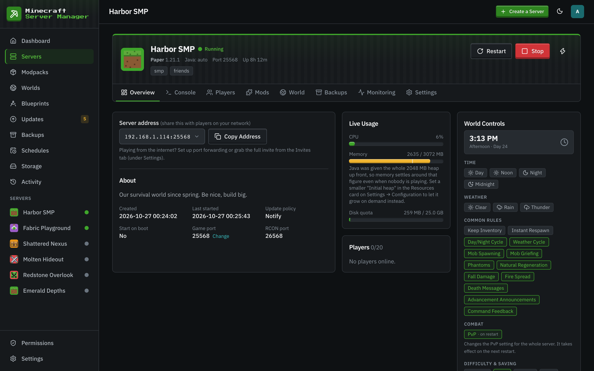

[← Назад к индексу документации](/docs/)

## Создание сервера

Нажмите **Создать сервер** (верхняя панель) или карточку **Создать сервер**, чтобы открыть мастер.

Мастер предварительно заполняет поля памяти, ЦП и дисковой квоты из раздела **Значения по умолчанию для новых серверов** на странице настроек, которые администратор может изменить в любое время.

Вы выбираете:

- **Имя** (и необязательные значок, акцентный цвет и теги для организации вашей сети серверов).
- **Тип сервера** — vanilla, Paper, Fabric, Forge, NeoForge и другие, каждый из которых соответствует нужному образу itzg "за кулисами".
- **Версию Minecraft** — `LATEST`, снимок или конкретную версию.
- **Ресурсы** — ОЗУ (куча), лимит памяти контейнера, ЦП и дисковая квота.

Предпочитаете модпак? Вкладка **Из модпака** вместо этого устанавливает модпак CurseForge, Modrinth, FTB или GT New Horizons (см. [Модпаки](/docs/modpacks/)) или принимает **загруженный вами пользовательский zip-архив**: экспорт модпака CurseForge (`manifest.json`) или любой zip-архив с модами. Манифест (или большинство голосов среди идентифицированных jar-файлов) определяет загрузчик и версию Minecraft, и каждый мод устанавливается за одну задачу. Вы также можете начать с сохраненного [Шаблона](/docs/blueprints/).

Панель автоматически выбирает подходящую среду выполнения Java для вашей версии, загружает образ, создает контейнер и (необязательно) запускает его — все это из одной формы.

## Список серверов

Страница **Серверы** отображает всю вашу сеть серверов со статусом и краткой статистикой.

## Отдельный сервер

Открытие сервера предоставляет вам рабочее пространство с вкладками:

- **Обзор** — статус, текущая статистика, время работы и основные элементы управления запуском/остановкой/перезапуском.
- **Консоль** — поток журналов в реальном времени и ввод команд, а также внутриигровой чат ([подробности](/docs/console-and-chat/)).
- **Игроки** — кто в сети, а также инвентарь, статистика и [команды чата](/docs/console-and-chat/).
- **Моды** — список установленных модов, [браузер модов](/docs/modpacks/) и обновления контента.
- **Мир** — [миры, карта в реальном времени и файловый менеджер](/docs/worlds-and-files/).
- **Резервные копии** — [снимки и восстановление](/docs/backups/) для этого сервера.
- **Мониторинг** — история и метрики в реальном времени для каждого сервера, включая отчеты о сбоях (см. ниже).
- **Настройки** — все о том, как работает сервер, а также [интеграции](/docs/integrations/) (Discord, страница статуса, приглашения, чат-бот).

Боковая панель **Управление миром** присутствует на каждой вкладке: внутриигровые часы, погода, общие игровые правила в виде переключателей и кнопка "Показать все правила мира" для остальных.

**Мониторинг → В реальном времени** показывает TPS и миллисекунды на тик, карточку состояния и стабильности с данными за последние 24 часа / 7 дней о сбоях и перезапусках, а также размеры каждого мира.

## Настройки сервера

Вкладка **Настройки** представляет собой полный интерфейс конфигурации: переименование, ресурсы, политика обновлений, автозапуск/автоперезапуск, переменные среды и расширенные переопределения Docker. Поля, изменяющие способ работы контейнера, четко помечены как требующие перезапуска.

**О счетчике памяти.** "ОЗУ (куча Java)" передается Java как начальный, так и максимальный размер кучи, и Java заполняет выделенную ей кучу в течение первой минуты, с флагами Aikar / MeowIce или без них. Таким образом, счетчик памяти стабилизируется примерно на размере кучи и остается там, даже когда никто не играет; отметка на счетчике показывает, где куча находится под пределом контейнера, а примечание под ним указывает на это. Если вы хотите, чтобы память соответствовала реальному использованию, установите меньшую **Начальную кучу** (расширенные настройки): на куче объемом 2 ГБ это снизило использование в режиме ожидания с 2,6 ГБ до примерно 1,3 ГБ по нашим измерениям. Java также нуждается в памяти вне кучи (около 0,5 ГБ для vanilla, от 1,5 до 2 ГБ для большого модпака), для чего и предназначен запас лимита контейнера. См. "Два лимита памяти" в README для получения точных цифр.

> Расширенные поля переопределения Docker (пользовательское имя контейнера, дополнительный порт и привязки монтирования, а также необработанные переопределения) доступны **только администраторам**, поскольку привязка монтирования в сочетании с доступом панели к Docker фактически дает права root на хосте. См. [Пользователи и роли](/docs/users-and-roles/).

## Отчеты о сбоях и анализ mclo.gs

Отчеты о сбоях (`crash-reports/*.txt` и файлы JVM `hs_err_pid*.log`) автоматически собираются, анализируются в однострочное резюме с указанием исключения и предполагаемых модов, и отображаются в разделе **Мониторинг → История**:

Каждая карточка отчета предлагает встроенный просмотрщик (с сворачиваемыми разделами и выделенными исключениями), копирование стека вызовов и загрузку, а также два действия [mclo.gs](https://mclo.gs):

- **Поделиться на mclo.gs** публикует отчет как общедоступную вставку и копирует ссылку — именно то, что просят авторы модов и службы поддержки Discord. Ссылка запоминается для отчета, поэтому ничего не загружается дважды.
- **Анализировать** запускает автоматизированные инсайты mclo.gs для вставки: известные проблемы с предложенными исправлениями (отсутствующие зависимости, несоответствия версий, распространенные конфликты модов), отображаемые прямо в панели.

Оба действия требуют явного подтверждения, поскольку вставка является общедоступной: отчеты о сбоях могут содержать имена игроков и полный список ваших модов. Панель никогда ничего не загружает самостоятельно.
