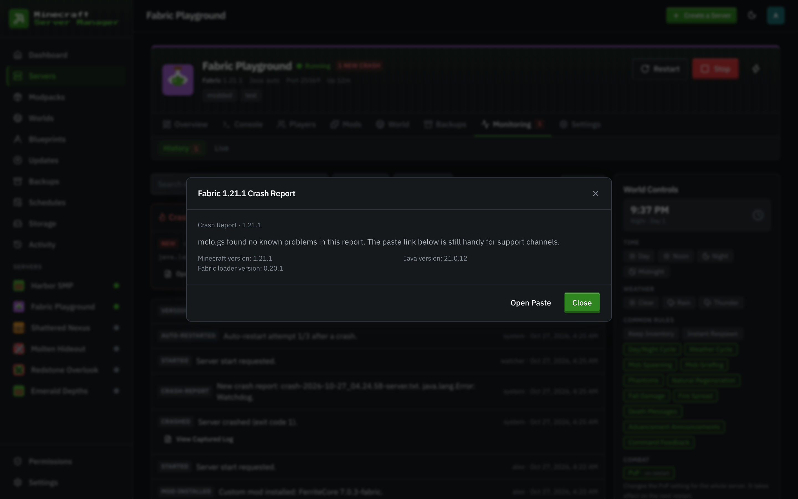

[← Назад к содержанию документации](/docs/)

## Создание сервера

Нажмите **Создать сервер** (верхняя панель) или карточку **Создать сервер**, чтобы открыть мастер.

Мастер предварительно заполняет объем памяти Java и дисковую квоту из раздела **Настройки по умолчанию для новых серверов** на странице настроек, которые администратор может изменить в любое время. Новый сервер также получает лимит ЦП оттуда.

Вы выбираете:

- **Имя** (и необязательное описание, значок и акцентный цвет). Теги для организации вашей коллекции добавляются позже, в настройках сервера.
- **Тип сервера**: Vanilla, Paper или Purpur на вкладке **Vanilla**. Для сервера с модами вкладка **Из модов** выбирает загрузчик (Fabric, Forge, NeoForge или Quilt), версию Minecraft и сборку загрузчика (последнюю или конкретную), а затем позволяет искать моды.
- **Версия Minecraft**: `LATEST`, снимок или конкретная версия (включая бета- и альфа-версии).
- **Игровой порт**: предлагается свободный. Удаленная консоль (RCON) использует порт на 1000 выше (по умолчанию). Вы можете изменить его позже (см. [Изменение игрового порта](#changing-the-game-port)).
- **Ресурсы**: память Java (лимит памяти контейнера устанавливается на 50% выше) и дисковая квота.

**Расширенные параметры** открывают все остальные настройки, поддерживаемые образом сервера, плюс дополнительные переменные среды и (для администраторов) расширенные настройки Docker.

Предпочитаете модпак? Вкладка **Из модпака** устанавливает пакет CurseForge, Modrinth или GT New Horizons вместо этого (см. [Модпаки](/docs/modpacks/)) или берет **пользовательский zip-архив, который вы загружаете**: Modrinth `.mrpack`, экспорт модпака CurseForge (`manifest.json`) или любой zip-архив с jar-файлами модов. Манифест (или большинство голосов среди идентифицированных jar-файлов) заполняет загрузчик и версию Minecraft, и каждый мод устанавливается за одну задачу. Вы также можете начать с сохраненного [Blueprint](/docs/blueprints/) на вкладке **Из Blueprint**.

Панель автоматически выбирает подходящую среду выполнения Java для вашей версии, загружает образ, создает контейнер и запускает его — все из одной формы.

## Список серверов

Страница **Серверы** отображает всю вашу коллекцию со статусом и краткой статистикой.

## Отдельный сервер

Открытие сервера предоставляет вам рабочее пространство с вкладками:

- **Обзор**: адрес для обмена с игроками, описание, текущее использование ресурсов и список онлайн-игроков.
- **Консоль**: поток логов в реальном времени и ввод команд, внутриигровой чат и [команды чата](/docs/console-and-chat/).
- **Игроки**: список игроков, а также инвентарь и статистика.
- **Моды**: список установленных модов, [браузер модов](/docs/modpacks/) и обновления контента. На сервере с модами вкладка **Версии** проверяет, для каких будущих версий Minecraft существуют сборки ваших модов ([обновления](/docs/updates/#minecraft-version-compatibility)).
- **Мир**: [миры, карта в реальном времени и файловый менеджер](/docs/worlds-and-files/).
- **Резервные копии**: [снимки и восстановление](/docs/backups/) для этого сервера.
- **Мониторинг**: история по серверам и метрики в реальном времени, включая отчеты о сбоях (см. ниже).
- **Настройки**: **Конфигурация** (все о том, как работает сервер), а также [интеграции](/docs/integrations/) (Discord, Страница статуса, Приглашения и, для администраторов, Чат-бот).

Элементы управления запуском, остановкой и перезапуском расположены в заголовке над каждой вкладкой. То, что вы можете делать на каждой вкладке, зависит от ваших [прав на этом сервере](/docs/users-and-roles/#per-server-permissions): например, подвкладка **Файлы** требует разрешения "Файлы", а отправка команд консоли — разрешения "Консоль".

Панель **Управление миром** перемещается по всем вкладкам: внутриигровые часы, погода, общие игровые правила в виде переключателей и "Показать все правила мира" для остальных.

**Мониторинг → В реальном времени** показывает TPS и миллисекунды на тик, карточку состояния и стабильности с информацией о сбоях (за последние 24 часа и 7 дней), завершениях из-за нехватки памяти и автоматических перезапусках, а также размеры по мирам.

## Настройки сервера

**Настройки → Конфигурация** — это полная поверхность конфигурации: имя, описание, MOTD, значок, цвет и теги, ресурсы, игровой порт, политика обновлений, запуск при загрузке панели и автоматический перезапуск при сбое, каждая переменная среды, поддерживаемая образом сервера, расширенные настройки Docker, а также экспорт, клонирование, перестроение и удаление Blueprint. Изменения, которые вступают в силу только после перестроения сервера, сохраняются немедленно и ждут: в заголовке сервера появляется кнопка **Применить изменения**, и они также применяются при следующем запуске сервера.

**Автоматический перезапуск при сбое** снова запускает сбойный сервер, увеличивая интервал между попытками (5, 10, затем 20 секунд) и останавливаясь после 3 попыток в течение 10 минут. Он пропускает сбои, которые панель распознает как проблемы с настройкой (EULA, неправильная Java, мир из более новой версии, занятый порт, нехватка памяти, отсутствующий ключ CurseForge), поскольку их сначала нужно исправить. Если другое действие занято сервером (резервное копирование, восстановление, изменение порта), оно ждет до 30 минут и сдается, как только кто-то сам останавливает или запускает сервер.

Прямые изменения настроек всегда сохраняются при перезапусках. Изменение PvP или сложности, сделанное с помощью панели **Управление миром**, переключение белого списка на вкладке **Игроки** или редактирование `server.properties` в редакторе **Файлы** удаляет соответствующую переменную среды (если она была установлена) и помечает сервер для перестроения, чтобы значение на диске имело приоритет над тем, что будет применено образом контейнера при следующем запуске.

**О счетчике памяти.** "ОЗУ (куча Java)" передается Java как начальная и максимальная куча, и Java заполняет выделенную кучу в течение первой минуты, с флагами Aikar / MeowIce или без них. Таким образом, счетчик памяти стабилизируется примерно на размере кучи и остается там, даже когда никто не играет; отметка на счетчике показывает, где куча находится под лимитом контейнера, и примечание под ним это подтверждает. Если вы предпочитаете, чтобы память соответствовала реальному использованию, установите для сервера меньшую начальную кучу с помощью **Начальная куча** в карточке "Ресурсы" на **Настройки → Конфигурация** (или в разделе **Расширенные параметры** в мастере), например, 512 МБ: при куче в 2 ГБ это снизило использование в простое с 2,6 ГБ примерно до 1,3 ГБ по нашим измерениям. Java также требует памяти вне кучи (около 0,5 ГБ для ванильной версии, 1,5–2 ГБ для большого модпака), для чего и предназначен запас лимита контейнера. См. README "Два лимита памяти" для получения точных цифр.

> **Расширенные настройки Docker** (имя контейнера, сеть Docker, дополнительные сопоставления портов и дополнительные привязки томов) доступны **только администраторам**, поскольку привязка тома в сочетании с доступом панели к Docker фактически предоставляет root-доступ к хосту. См. [Пользователи и роли](/docs/users-and-roles/).

### Изменение игрового порта

Карточка **Игровой порт** на странице **Настройки → Конфигурация** позволяет переместить сервер на другой порт в любое время, с собственной кнопкой **Сохранить порт**. **Использовать следующий свободный порт** выбирает наименьший свободный порт, и карточка проверяет любой введенный вами порт перед сохранением. RCON всегда следует за игровым портом, отставая на 1000 (смещение по умолчанию). Администраторы могут выбирать любой порт от 1024 и выше; все остальные выбирают из первого игрового порта (по умолчанию 25565) и выше. Сохранение немедленно применяет изменение: остановленный сервер просто перемещается, а запущенный сервер сначала запрашивает подтверждение, а затем перезапускается на новом порту (мир сохраняется первым, и игроки переподключаются на новом порту). Если сервер не может запуститься на новом порту, он возвращается к старому. Изменение отклоняется, пока другие изменения ждут **Применить изменения**, поэтому сначала примените их. Изменение порта требует разрешения "Настройки" для этого сервера.

## Отчеты о сбоях и анализ mclo.gs

Отчеты о сбоях (`crash-reports/*.txt` и файлы JVM `hs_err_pid*.log`) автоматически собираются, парсятся в однострочное резюме с указанием исключения и предполагаемых модов, и отображаются в разделе **Мониторинг → История**:

Каждая карточка отчета предлагает встроенный просмотрщик (с сворачиваемыми разделами и выделенными исключениями), копирование стека вызовов и загрузку, а также два действия [mclo.gs](https://mclo.gs):

- **Отправить на mclo.gs** публикует отчет как общедоступную вставку и копирует ссылку: именно то, что просят авторы модов и службы поддержки Discord. Ссылка сохраняется для отчета, поэтому ничего не загружается дважды.
- **Анализировать** запускает автоматические инсайты mclo.gs для вставки: известные проблемы с предложенными исправлениями (отсутствующие зависимости, несоответствия версий, распространенные конфликты модов), отображаемые прямо в панели.

Оба действия требуют явного подтверждения, поскольку вставка является общедоступной: отчеты о сбоях могут содержать имена игроков и полный список ваших модов. Панель никогда ничего не загружает самостоятельно.
