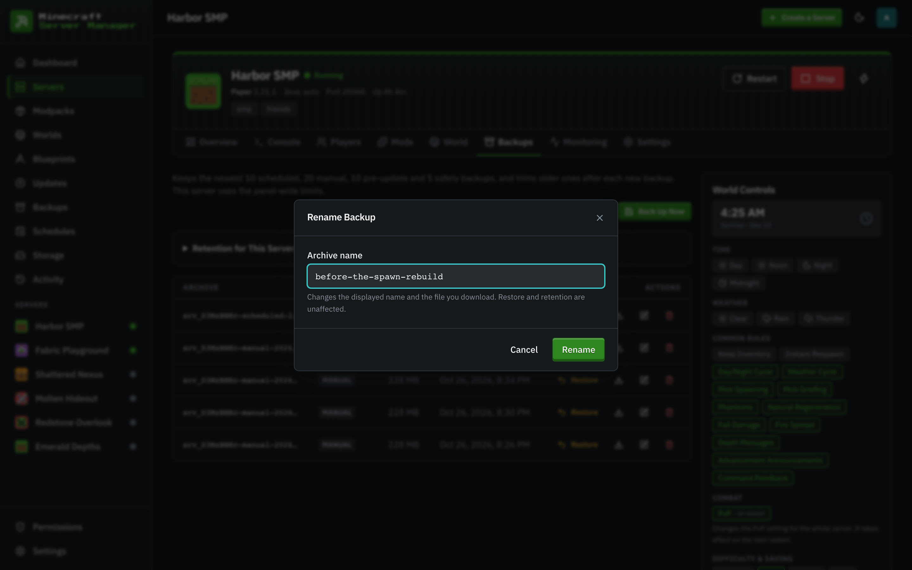

[← Tillbaka till dokumentindex](/docs/)

**Säkerhetskopior**-sidan visar alla ögonblicksbilder från din flotta, med storlek, anledning och ålder.

## Skapa en säkerhetskopia

Från en servers flik **Säkerhetskopior** (eller via ett [schema](/docs/schedules/)) kan du ögonblicksbilda hela serverkatalogen med ett enda klick. Panelen stänger ner världen först (`save-off` → `save-all`), zippar data, och återaktiverar sedan sparande (`save-on`), så säkerhetskopior är konsekventa även på en körande server. Komprimering körs i en bakgrundstråd så att den inte blockerar panelen. Varje säkerhetskopia kan bära en anteckning.

Varje arkiv **integritetskontrolleras** i samma ögonblick som det skrivs: panelen återöppnar zip-filen och läser dess katalog. Ett skadat eller oläsbart arkiv raderas och säkerhetskopieringsanropet misslyckas omedelbart, istället för att problemet dyker upp månader senare när en återställning är det enda som skiljer dig från dataförlust. Ett arkiv med noll poster (en server som aldrig har startats) tillåts men flaggas i händelseloggarna.

Markera **"Krymp även världen efteråt"** (på fliken Säkerhetskopior, eller i ett säkerhetskopieringsschema) för att ta bort sällan besökta bitar när arkivet har skrivits säkert (se **[Krympa en värld](/docs/world-shrink/)**). Krympningen körs endast medan servern är stoppad; på en körande server sker säkerhetskopieringen fortfarande och krympningen hoppas över.

## Anledningar till säkerhetskopior

Säkerhetskopior taggas baserat på varför de togs:

- **manuell** - du klickade på knappen.
- **schemalagd** - skapad av ett [schema](/docs/schedules/). Varje ny server får också en daglig schemalagd säkerhetskopia automatiskt (spridd mellan 02:00 och 05:59), så en server har automatisk täckning från dag ett, inte bara före uppdateringar.
- **före-uppdatering** - tas automatiskt före en paketuppgradering, så en uppgradering alltid kan ångras.
- **före-återställning** - tas automatiskt precis före en återställning eller en världsåterställning, som ett skyddsnät om återställningen inte blev som du tänkt dig.

## Kvarhållning

Kvarhållningen är begränsad **per server, per anledning**: de nyaste i varje grupp behålls, äldre rensas automatiskt efter varje lyckad säkerhetskopia:

| Anledning          | Behålls |
| ------------------ | ------- |
| schemalagd         | 10      |
| före-uppdatering   | 10      |
| manuell            | 20      |
| före-återställning | 5       |

`före-återställning` har sin egen lilla hink just för att en automatisk säkerhetskopia aldrig ska kunna radera en `manuell` säkerhetskopia som du avsiktligt behållit.

Två valfria tak gäller utöver antalet per anledning, båda avstängda som standard: en **maximal ålder** (säkerhetskopior äldre än N dagar rensas, oavsett anledning) och en **maximal total storlek** per server (de äldsta säkerhetskopiorna rensas tills totalen passar, `före-återställning`-kopior först). Den nyaste säkerhetskopian av en server rensas aldrig av något av dessa tak. Alla dessa kan ändras globalt på sidan Inställningar, och åsidosättas per server på dess flik Säkerhetskopior.

Säkerhetskopior kan **döpas om** från säkerhetskopielistan (knappen döp om på varje rad). Arkivet på disken och panelens register flyttas tillsammans, så nedladdning, återställning och kvarhållning fortsätter att fungera med det nya namnet.

> Kvarhållningen är automatiskt begränsad, men stora modifierade arkiv räknas fortfarande mot en servers [disk-kvot](/docs/storage/), så håll ett öga på totalen för stora paket.

## Återställa

Att återställa en säkerhetskopia stoppar servern (verifierar att containern verkligen stoppades innan några filer rörs), tar en `före-återställning`-säkerhetskopia, ersätter **hela serverkatalogen** med ögonblicksbilden och lämnar den stoppad så att du kan starta den igen. Eftersom paketuppgraderingar alltid tar en `före-uppdatering`-säkerhetskopia först, kan du alltid rulla tillbaka en dålig uppgradering.

## Panelens egen databas

Server-säkerhetskopior täcker endast per-server-världskataloger. Panelens egen databas (`panel.db`, som innehåller användare, roller, 2FA-hemligheter, scheman, paket-pins och historik) tas ögonblicksbild av separat vid den dagliga underhållstimern:

- `VACUUM INTO` skriver en konsekvent, defragmenterad kopia till `data/backups/_panel/`; de nyaste **14** behålls.
- Vid uppstart kör panelen `PRAGMA integrity_check` och loggar högt om den misslyckas, och pekar dig mot `data/backups/_panel` för den senaste bra kopian.

Säkerhetskopiera hela `data/`-trädet (det innehåller också `.secret-key`, krypteringsnyckeln i vila) och du har säkerhetskopierat allt.
