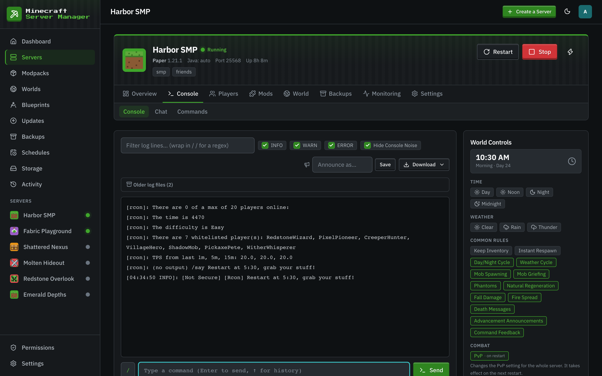

[← Tillbaka till dokumentindex](/docs/)

## Livekonsolen

**Konsol**-fliken strömmar serverloggen i realtid och ger dig ett kommandofält för att skicka alla serverkommandon. Ingen `docker exec`, ingen SSH. Utdata kommer tillbaka direkt, med färger och allt. För att skicka kommandon krävs Console-behörigheten på den servern; utan den kan du fortfarande se loggen.

Ovanför loggen kan du filtrera rader efter text (eller ett `/regex/`) och efter nivå (INFO, WARN, ERROR), och **Ladda ner** erbjuder den senaste utdatan, hela `latest.log`, eller alla loggfiler som en zipfil.

Konsolen är också där panelen läser serverns tillstånd: den övervakar loggen för att klassificera uppstartsfasen ("Laddar mods", "Genererar värld", "Avslutar start") och anropar `list` för att spåra vilka som är online, så instrumentpanelen och serverkorten alltid återspeglar verkligheten.

Denna avläsning öppnar en kortlivad RCON-anslutning varje cykel, vilket servern loggar som ett par `Thread RCON Client … started` / `shutting down` var ~20:e sekund, och (på servrar vars kärna eller plugins upprepar det) en rad `Rcon issued server command: …` för varje skrivskyddad avläsning (`list` för spelarantal, plus `time query …` och `gamerule <name>`-läsningar medan World Controls är öppet). **Dölj konsolljud**-växeln ovanför loggen filtrerar bort dessa rader (tillsammans med startraderna för RCON-lyssnaren). Den är på som standard och sparas per webbläsare; stäng av den för att se den råa strömmen.

Kommandon som skickas från panelen kan annonseras i spelet under en per-server-etikett (rutan **Annonsera som…**), så spelare vet att en operatör agerade snarare än en mystisk konsol.

## Chatt

**Konsol → Chatt** skickar meddelanden till spelet medan servern körs: **Stilade** meddelanden tar färger och formatering och kan skickas till alla eller en enskild online-spelare, och **Enkla** skickar en enkel `[Server]`-sändning till alla.

## Chattkommandon

Chattkommandon (**Konsol → Kommandon**) låter spelare utlösa panelåtgärder genom att skriva ett prefixkommando i spelchatten, till exempel `!spawn` för slumpmässig teleportering. Detektering är loggbaserad och exekvering sker via servern, så **inga mods krävs**.

Varje kommando har:

- En **utlösare** (t.ex. `spawn`), som skrivs efter serverns **prefix** (`!` som standard, ett eller två tecken, aldrig `/`).
- En **åtgärd**: slumpmässig teleportering, teleportering till en struktur, teleportering till en biom, eller kör råa konsollkommandon.
- En **behörighetsnivå**: alla, vitlistade spelare, eller endast operatörer.
- En **nedkylningstid** per spelare (30 sekunder som standard), och anpassningsbara meddelanden för väntande / lyckade / misslyckade försök med platshållare som `{distance}`.

### En notering om säkerhet

Kommandon som kan förstöra en server (`stop`, `op`, `ban`, `whitelist` och liknande) är endast tillåtna på **endast operatör**-utlösare. Panelkontrollen kontrollerar detta även när de är kapslade inuti en `execute … run …`-kedja, så en utlösare med låg behörighet kan inte smuggla igenom ett farligt kommando. Vanlig chatttext som bara nämner dessa ord (som ett `say`-meddelande) lämnas ifred.
