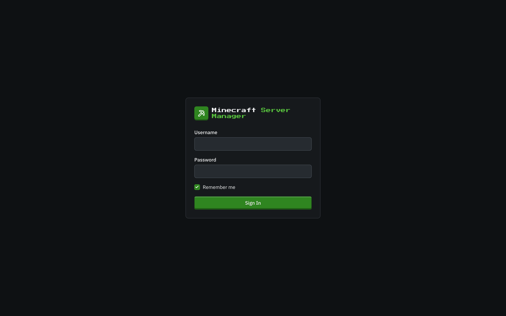

[← Tillbaka till dokumentindex](/docs/)

## Första installationen

Första gången du öppnar panelen guidar en kort installationsguide dig igenom det:

1.  **Systemkontroll** säkerställer att Docker är nåbart, Node.js är tillräckligt nytt och att datamappen går att skriva till. Om Docker inte körs än kan du ändå fortsätta; att skapa och starta servrar väntar tills det är igång.
2.  **Skapa ditt administratörskonto**. Detta är det enda kontot som finns tills du lägger till fler, och det har full kontroll. Välj ett användarnamn (2 till 32 tecken) och ett lösenord på minst 8 tecken. Du loggas in så fort det skapas.
3.  **Panelkonfiguration** (valfritt): en publik domän att visa spelare i anslutningsadresser, en CurseForge API-nyckel och din tidszon. Allt kan ändras senare i **Inställningar**.

Det sista steget erbjuder **Skapa en server** eller **Gå till instrumentpanelen**.

> **Exponerade installationer är PIN-skyddade.** Om du startar panelen bunden till en adress som inte är loopback (`PANEL_HOST` annat än `127.0.0.1`), ber installationssidan också om en **6-siffrig PIN-kod**. Panelprogrammet skriver ut den till sin konsol vid uppstart. Ange den tillsammans med ditt användarnamn och lösenord. Detta hindrar en främling som når porten först från att ta över administratörskontot. PIN-koden försvinner när administratörskontot finns.

## Inloggning

Efter installationen skyddas panelen av en inloggningsskärm. Ange ditt användarnamn och lösenord för att fortsätta.

Om [tvåfaktorsautentisering](/docs/two-factor-authentication/) är aktiverat på ditt konto, kommer du att bli ombedd att ange en 6-siffrig kod från din autentiseringsapp direkt efter ditt lösenord.

## Hitta runt

Allt hänger på sidomenyn till vänster:

- **Instrumentpanel** - alla servrar i en överblick ([detaljer](/docs/dashboard/)).
- **Servrar**, **Modpacks**, **Världar**, **Ritningar** - skapa och hantera servrar och deras innehåll.
- **Uppdateringar**, **Säkerhetskopior**, **Scheman**, **Lagring**, **Aktivitet** - den operativa sidan: vad som är föråldrat, dina ögonblicksbilder, automatisering, diskutrymme och granskningsloggen.
- **Behörigheter** (längst ner, endast för administratörer): vad varje användare får göra på varje server ([detaljer](/docs/users-and-roles/#per-server-permissions)).
- **Inställningar** (längst ner, endast för administratörer): API-nycklar, panelkonfiguration, standardinställningar för nya servrar, [lagringstid för säkerhetskopior](/docs/backups/#retention), användare, inloggningssäkerhet och det publika API:et.

Nedanför dessa listar sidomenyn dina servrar. Att öppna en visar dess egna flikar: **Översikt**, **Konsol**, **Spelare**, **Moddar**, **Värld**, **Säkerhetskopior**, **Övervakning** och **Inställningar**, de flesta med relaterade underflikar (till exempel, **Inställningar → Konfiguration** innehåller serverns inställningar och dess spelport). Se [En enskild server](/docs/servers/#a-single-server).

Överst har toppfältet knappen **Skapa en server**, en **växling för tema** (mörkt/ljust) och din **kontomeny**, där du kan ändra din profilbild, hantera [tvåfaktorsautentisering](/docs/two-factor-authentication/) eller logga ut.

## På en telefon eller surfplatta

Varje sida är utformad för en smal skärm först och breddas därifrån: sidomenyn göms bakom menyknappen, datatabeller staplas till kort, verktygsfält lindas och kontrollfältet för världen kollapsar till ett kort som du öppnar när du behöver det. Knappar och chip har en verklig målstorlek för beröring. Ingenting är endast för datorer.

  
  
  
  
  
  

## Vad du behöver

Panelen kommunicerar med Docker för att köra servrar, så den behöver tillgång till en Docker-daemon (Docker Desktop eller en Docker Engine-socket). När Docker är nåbart visar instrumentpanelens Docker-bricka **Ansluten** och dess version. Om den inte är det, körs panelen ändå. Du kan bara inte starta servrar förrän daemonen är igång.

## Nästa steg

- [Skapa din första server →](/docs/servers/)
- [Säkra ditt konto med 2FA →](/docs/two-factor-authentication/)
