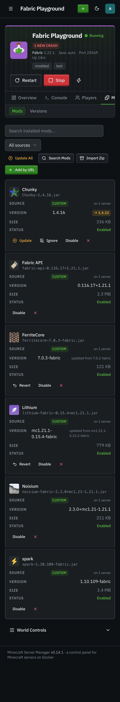

[← Tillbaka till dokumentindex](/docs/)

## Första installationen

Första gången du öppnar panelen uppmanas du att skapa ett administratörskonto. Detta är det enda kontot som finns tills du lägger till fler, och det har full kontroll.

Välj ett användarnamn och ett lösenord på minst 8 tecken. Det är allt: du är inloggad och tas direkt till instrumentpanelen.

> **Exponerade installationer är PIN-skyddade.** Om du startar panelen bunden till en adress som inte är loopback (`PANEL_HOST` annat än `127.0.0.1`), frågar installationssidan också efter en **6-siffrig PIN-kod**. Panelens skriver ut den i sin konsol vid uppstart. Ange den tillsammans med ditt användarnamn och lösenord. Detta hindrar en främling som når porten först från att ta över administratörskontot. PIN-koden försvinner när administratörskontot finns.

## Inloggning

Efter installationen skyddas panelen av en inloggningsskärm. Ange ditt användarnamn och lösenord för att fortsätta.

Om [tvåfaktorsautentisering](/docs/two-factor-authentication/) är aktiverad på ditt konto, kommer du att bli ombedd att ange en 6-siffrig kod från din autentiseringsapp direkt efter ditt lösenord.

## Hitta runt

Allt hänger på sidomenyn till vänster:

- **Instrumentpanel** - alla servrar i en överblick ([detaljer](/docs/dashboard/)).
- **Servrar**, **Modpacks**, **Världar**, **Ritningar** - skapa och hantera servrar och deras innehåll.
- **Uppdateringar**, **Säkerhetskopior**, **Scheman**, **Lagring**, **Aktivitet** - den operativa sidan: vad som är föråldrat, dina ögonblicksbilder, automatisering, diskutrymme och aktivitetsloggen.
- **Inställningar** (längst ner): användare, API-nycklar och panelkonfiguration.

Överst finns knappen **Skapa en server**, en **temaväxlare** (mörk/ljus) och din **kontomeny**, där du kan hantera [tvåfaktorsautentisering](/docs/two-factor-authentication/) eller logga ut.

## På en telefon eller surfplatta

Varje sida är utformad för en smal skärm först och breddas därifrån: sidomenyn gömmer sig bakom menyknappen, datatabeller staplas till kort, verktygsfält lindas och världskontrollerna kollapsar till ett kort som du öppnar när du behöver det. Knappar och chip har en verklig beröringsyta. Ingenting är endast för datorer.

  
  
  
  
  

## Vad du behöver

Panelen kommunicerar med Docker för att köra servrar, så den behöver tillgång till en Docker-daemon (Docker Desktop eller en Docker Engine-socket). När Docker är nåbart visar instrumentpanelens Docker-ruta **Ansluten** och dess version. Om den inte är det, körs panelen fortfarande. Du kan bara inte starta servrar förrän daemonen är igång.

## Nästa steg

- [Skapa din första server →](/docs/servers/)
- [Säkra ditt konto med 2FA →](/docs/two-factor-authentication/)
