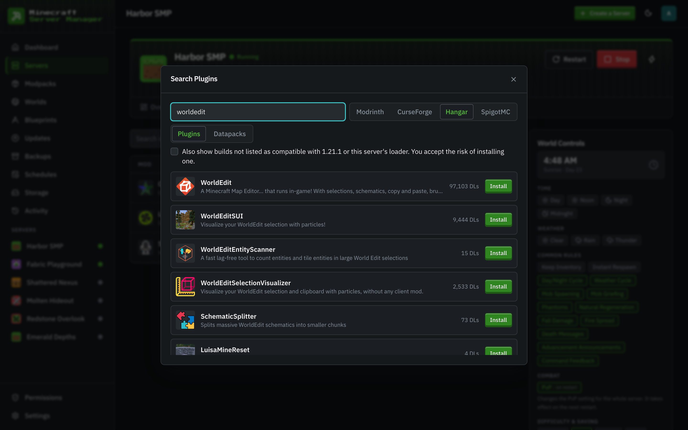

[← Tillbaka till dokumentindex](/docs/)

## Världar

**Världar**-sidan är världbiblioteket: varje sparad värld på ett ställe. **Ladda upp värld** tar ett `.zip` eller `.tar`-arkiv och hittar automatiskt världen inuti, **Spara till bibliotek** skapar en ögonblicksbild av en servers aktiva värld (det fungerar medan servern körs), och varje biblioteksvärld kan laddas ner eller installeras till vilken server som helst med **Installera till…**. Installation ersätter antingen serverns värld (servern måste vara stoppad, och dess nuvarande värld säkerhetskopieras först) eller lägger till den vid sidan av, för att aktiveras senare. En kompatibilitetskontroll körs före varje installation.

En servers egen flik **Värld → Världar** listar världarna på den servern. Därifrån kan du aktivera en annan värld (med servern stoppad), ladda ner, duplicera, byta namn på eller [krympa](/docs/world-shrink/) en värld, kopiera den till en annan server, ta bort en inaktiv, och återställa den aktiva världen med ett nytt, behållet eller anpassat frö (en säkerhetskopia erbjuds först). Samma bibliotek finns nedan, med **Installera här**.

## Filhanteraren

Under en servers sektion **Värld**, är fliken **Filer** en fullständig filhanterare i webbläsaren för serverns datakatalog. Lista, läs, redigera, byt namn på, flytta, kopiera, ta bort och ladda upp filer, skapa mappar och sök text i filer under en mapp med **Sök i filer**: allt du normalt skulle göra via SSH, från webbläsaren.

Textfiler öppnas i en redigerare med en gräns på 8 MB; större filer kan laddas ner. Uppladdningar accepterar upp till 20 filer samtidigt.

### Stanna inom sandlådan

Varje filoperation är begränsad till serverns egen datakatalog. Panelens löser varje sökväg och vägrar allt som skulle bryta sig ut: `..`-traversering, absoluta sökvägar, och även symboliska länkar som pekar utanför katalogen (inklusive hängande som ännu inte existerar). En mod eller plugin kan inte plantera en länk för att lura filhanteraren att läsa eller skriva någon annanstans på värden.

## Mods

För servrar med mods och plugins, hanterar fliken **Mods** (en egen grupp i serverns sidofält) moduppsättningen: bläddra och lägg till mods, och se vad som är installerat. Från varje installerad mods rad kan du uppdatera den (eller ignorera den uppdateringen), [återställa](/docs/updates/#undoing-a-mod-update) den, inaktivera den, eller ta bort den, och **Uppdatera alla** tillämpar alla tillgängliga uppdateringar med en omstart. Mod- och packuppdateringar visas också på sidan [Uppdateringar](/docs/updates/).

### Lägga till mods

Fyra vägar in, alla från verktygsfältet på Mods-fliken:

- **Sök mods**: sök **Modrinth eller CurseForge** (CurseForge-knappen visas när en API-nyckel har lagrats under **Inställningar → API-nycklar**), och på plugin-servrar även **Hangar** (PaperMC:s egen plugin-register) och **SpigotMC** (via Spigets CDN-proxy), båda utan nyckel. En flik **Datapacks** söker Modriths datapacks. Allt filtreras till serverns laddare och Minecraft-version (en kryssruta visar även byggen som inte listas som kompatibla, på egen risk); Quilt-servrar ser automatiskt även fabric-taggade byggen, eftersom Quilt kör Fabric-mods. Resultat som redan finns på servern visar en **Installerats**-etikett. Om en CurseForge-författare inte tillåter automatisk nedladdning (eller en SpigotMC-resurs är hostad externt), meddelar panelen det direkt och erbjuder en **Öppna CurseForge** (eller **Öppna SpigotMC**) + **Ladda upp Jar**-väg istället för att misslyckas mitt i installationen.

  

- **Importera Zip**: en knapp, tre former, automatiskt upptäckt:
  - Ett **Modrinth modpack (`.mrpack`)**: varje fäst fil normaliseras tillbaka till sitt Modrinth-projekt via hash-uppslag (så importerade mods behåller riktiga namn, ikoner och förblir uppdateringsbara; filer som Modrinth inte känner till installeras från packens egen URL), verifieras mot packens sha512-kontrollsummor under nedladdning, och förhandsgranskas med passande domar. Endast klientfiler hoppas över synligt, och båda överlappande träd (`overrides/`, sedan `server-overrides/`; den serverspecifika kopian vinner) kan tillämpas.

    

  - En **CurseForge modpack-export** (zip-filen som CurseForge-appen producerar, med `manifest.json`): varje fäst mod löses upp i bulk, förhandsgranskas med varningar (fel laddare/MC för denna server, filer som inte längre finns på CurseForge, mods som kräver manuell nedladdning), och installeras med verklig framsteg. Packens `overrides/` (konfigurationer, skript) kan också tillämpas; alla filer som skulle skrivas över säkerhetskopieras först till `.import-backups/<timestamp>/` inuti servermappen.
  - En **vanlig zip med jar-filer** som du samlat själv: varje jar identifieras (Modrinth hash-match → CurseForge fingeravtryck → jar-filens egen metadata) och bedöms mot servern (_passar / fel laddare / fel MC-version / redan installerad / oidentifierad_), så du väljer vad som faktiskt hör hemma innan något installeras.
- **Lägg till via URL**: klistra in nästan vad som helst: Modrinth, CurseForge, Hangar, eller SpigotMC projektsidor, en GitHub repo eller release URL (enbart `ägare/repo` fungerar också; GitHub-installationer föredrar den senaste stabila releasen och hoppar över `-sources`/`-javadoc` sidofiler), enbart Modrinth-slug, eller vilken direkt `.jar`-URL som helst. Panelens löser rätt bygg för serverns laddare och MC-version.

  

- **Ladda upp Jar** (från sök-fallback eller upplösaren för väntande nedladdningar): uppladdade jar-filer identifieras på samma sätt, så de behåller sitt riktiga namn, version, ikon och blir uppdateringsbara.

Varje registerinstallation är **kontrollsumme-verifierad under nedladdning**: strömmen kontrolleras mot den starkaste digest som registret publicerar (sha512 → sha256 → sha1 → md5) och en mismatch avbryts innan något landar på servern.

En hel zip (`.mrpack` inkluderad) kan också **skapa en server**: i guiden **Från Modpack**-fliken, ladda upp den och packens manifest (eller en majoritetsröstning bland de identifierade jar-filerna) fyller i laddaren, Minecraft-versionen och laddarens bygg.
