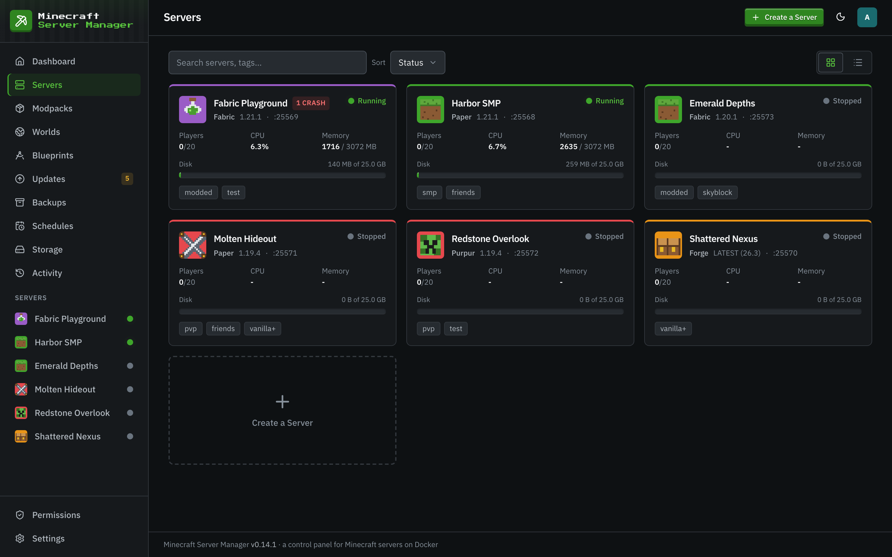

[← กลับไปยังดัชนีเอกสาร](/docs/)

## การสร้างเซิร์ฟเวอร์

คลิก **Create a Server** (แถบด้านบน) หรือการ์ด **Create a server** เพื่อเปิดวิซาร์ด

วิซาร์ดจะเติมข้อมูลในช่องหน่วยความจำ, CPU และโควต้าดิสก์จาก **Defaults for new servers** ในหน้า Settings ซึ่งผู้ดูแลระบบสามารถเปลี่ยนแปลงได้ตลอดเวลา

คุณสามารถเลือก:

- **ชื่อ** (และไอคอน, สีเน้น, และแท็กเสริมเพื่อจัดระเบียบเซิร์ฟเวอร์ของคุณ)
- **ประเภทเซิร์ฟเวอร์** - vanilla, Paper, Fabric, Forge, NeoForge และอื่นๆ ซึ่งแต่ละประเภทจะจับคู่กับอิมเมจ itzg ที่ถูกต้องเบื้องหลัง
- **เวอร์ชัน Minecraft** - `LATEST`, snapshot หรือเวอร์ชันที่ระบุ
- **ทรัพยากร** - RAM (heap), ขีดจำกัดหน่วยความจำของคอนเทนเนอร์, CPU และโควต้าดิสก์

ต้องการ modpack ไหม? แท็บ **From modpack** จะติดตั้งแพ็ค CurseForge, Modrinth, FTB หรือ GT New Horizons แทน (ดู [Modpacks](/docs/modpacks/)) หรือใช้ **custom zip ที่คุณอัปโหลด**: การส่งออก modpack ของ CurseForge (`manifest.json`) หรือ zip ของ mod jar ใดๆ manifest (หรือการโหวตส่วนใหญ่จาก jar ที่ระบุ) จะเติมข้อมูล loader และเวอร์ชัน Minecraft และ mod ทุกตัวจะถูกติดตั้งในหนึ่งงาน คุณยังสามารถเริ่มต้นจาก [Blueprint](/docs/blueprints/) ที่บันทึกไว้ได้

แผงควบคุมจะเลือก Java runtime ที่เหมาะสมสำหรับเวอร์ชันของคุณโดยอัตโนมัติ ดึงอิมเมจ สร้างคอนเทนเนอร์ และ (เลือกได้) เริ่มต้นคอนเทนเนอร์ ทั้งหมดนี้จากฟอร์มเดียว

## รายการเซิร์ฟเวอร์

หน้า **Servers** จะแสดงเซิร์ฟเวอร์ทั้งหมดของคุณพร้อมสถานะและสถิติอย่างรวดเร็ว

## เซิร์ฟเวอร์เดียว

การเปิดเซิร์ฟเวอร์จะทำให้คุณมีพื้นที่ทำงานแบบแท็บ:

- **Overview** - สถานะ, สถิติสด, uptime และการควบคุมหลักในการเริ่ม / หยุด / รีสตาร์ท
- **Console** - สตรีมบันทึกสดและการป้อนคำสั่ง รวมถึงแชทในเกม ([รายละเอียด](/docs/console-and-chat/))
- **Players** - ผู้ที่ออนไลน์อยู่ พร้อมด้วย inventory, สถิติ และ [คำสั่งแชท](/docs/console-and-chat/)
- **Mods** - รายการ mod ที่ติดตั้ง, [mod browser](/docs/modpacks/) และการอัปเดตเนื้อหา
- **World** - [โลก, แผนที่สด และตัวจัดการไฟล์](/docs/worlds-and-files/)
- **Backups** - [snapshots และการกู้คืน](/docs/backups/) สำหรับเซิร์ฟเวอร์นี้
- **Monitoring** - ประวัติและเมตริกสดต่อเซิร์ฟเวอร์ รวมถึงรายงานข้อขัดข้อง (ดูด้านล่าง)
- **Settings** - ทุกอย่างเกี่ยวกับวิธีการทำงานของเซิร์ฟเวอร์ รวมถึง [การผสานรวม](/docs/integrations/) (Discord, หน้าสถานะ, คำเชิญ, chatbot)

แถบ **World Controls** จะอยู่กับทุกแท็บ: นาฬิกาในเกม, สภาพอากาศ, gamerules ทั่วไปในรูปแบบ toggle chips และ "Show all world rules" สำหรับส่วนที่เหลือ

**Monitoring → Live** แสดง TPS และ milliseconds per tick, การ์ดสุขภาพและความเสถียรพร้อมรายงานข้อขัดข้องและการรีสตาร์ทในช่วง 24 ชั่วโมง / 7 วันที่ผ่านมา และขนาดต่อโลก

## การตั้งค่าเซิร์ฟเวอร์

แท็บ **Settings** คือพื้นผิวการกำหนดค่าทั้งหมด: เปลี่ยนชื่อ, ทรัพยากร, นโยบายการอัปเดต, การเริ่ม / รีสตาร์ทอัตโนมัติ, ตัวแปรสภาพแวดล้อม และการตั้งค่า Docker ขั้นสูง ช่องที่เปลี่ยนแปลงวิธีการทำงานของคอนเทนเนอร์จะถูกทำเครื่องหมายไว้อย่างชัดเจนว่าต้องรีสตาร์ท

**เกี่ยวกับมาตรวัดหน่วยความจำ** "RAM (Java heap)" จะถูกส่งไปยัง Java เป็นทั้งจุดเริ่มต้นและขีดจำกัดสูงสุดของ heap และ Java จะเติม heap ที่ได้รับไว้ล่วงหน้าภายในนาทีแรก ไม่ว่าจะใช้ Aikar / MeowIce flag presets หรือไม่ ดังนั้นมาตรวัดหน่วยความจำจะคงที่ประมาณขนาด heap และยังคงอยู่ที่นั่นแม้จะไม่มีใครเล่น การขีดบนมาตรวัดจะทำเครื่องหมายตำแหน่งที่ heap อยู่ภายใต้ขีดจำกัดของคอนเทนเนอร์ และข้อความใต้มาตรวัดจะระบุเช่นนั้น หากคุณต้องการให้หน่วยความจำติดตามการใช้งานจริง ให้ตั้งค่า **Initial heap** ที่เล็กลง (ขั้นสูง): บน heap ขนาด 2 GB ซึ่งลดการใช้งานขณะไม่ได้ใช้งานจาก 2.6 GB เป็นประมาณ 1.3 GB ในการวัดของเรา Java ยังต้องการหน่วยความจำนอก heap (ประมาณ 0.5 GB สำหรับ vanilla, 1.5 ถึง 2 GB สำหรับ modpack ขนาดใหญ่) ซึ่งเป็นส่วนที่ headroom ของขีดจำกัดคอนเทนเนอร์มีไว้สำหรับ ดู "Two memory limits" ใน README สำหรับตัวเลข

> ช่องการตั้งค่า Docker ขั้นสูง (ชื่อคอนเทนเนอร์ที่กำหนดเอง, พอร์ตเพิ่มเติมและการ bind mount, และการตั้งค่าดิบ) เป็น **สำหรับผู้ดูแลระบบเท่านั้น** เนื่องจาก bind mount ร่วมกับการเข้าถึง Docker ของแผงควบคุมนั้นเทียบเท่ากับ root บนโฮสต์ ดู [Users & roles](/docs/users-and-roles/)

## รายงานข้อขัดข้อง & การวิเคราะห์ mclo.gs

รายงานข้อขัดข้อง (`crash-reports/*.txt` และไฟล์ JVM `hs_err_pid*.log`) จะถูกดึงมาโดยอัตโนมัติ แยกวิเคราะห์เป็นสรุปบรรทัดเดียวพร้อม exception และ mod ที่สงสัย และแสดงรายการภายใต้ **Monitoring → History**:

การ์ดรายงานแต่ละใบมี viewer ในตัว (พร้อมส่วนที่ยุบได้และ exception ที่เน้น) คัดลอก stack trace และดาวน์โหลด พร้อมด้วยการดำเนินการ [mclo.gs](https://mclo.gs) สองรายการ:

- **Share to mclo.gs** จะเผยแพร่รายงานเป็น public paste และคัดลอกลิงก์ - สิ่งที่ผู้พัฒนา mod และ Discord สนับสนุนร้องขอพอดี ลิงก์จะถูกจดจำไว้ในรายงาน ดังนั้นจะไม่มีการอัปโหลดซ้ำ
- **Analyze** จะรันการวิเคราะห์อัตโนมัติของ mclo.gs กับ paste: ปัญหาที่ทราบพร้อมวิธีแก้ไขที่แนะนำ (dependencies ที่ขาดหายไป, ความไม่เข้ากันของเวอร์ชัน, ความขัดแย้งของ mod ทั่วไป) แสดงผลโดยตรงในแผงควบคุม

การดำเนินการทั้งสองรายการอยู่ภายใต้การยืนยันที่ชัดเจน เนื่องจาก paste เป็นสาธารณะ: รายงานข้อขัดข้องอาจมีชื่อผู้เล่นและรายการ mod ทั้งหมดของคุณ แผงควบคุมจะไม่ทำการอัปโหลดสิ่งใดด้วยตนเอง
