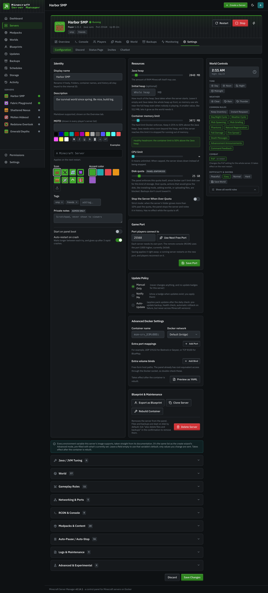

[← กลับไปยังดัชนีเอกสาร](/docs/)

## การสร้างเซิร์ฟเวอร์

คลิก **Create a Server** (แถบด้านบน) หรือการ์ด **Create a Server** เพื่อเปิดวิซาร์ด

วิซาร์ดจะเติมค่า Java heap และ disk quota ล่วงหน้าจาก **Defaults for new servers** ในหน้า Settings ซึ่งผู้ดูแลระบบสามารถเปลี่ยนแปลงได้ตลอดเวลา เซิร์ฟเวอร์ใหม่จะใช้ CPU limit จากที่นี่ด้วย

คุณสามารถเลือก:

- **ชื่อ** (และคำอธิบาย ไอคอน และสีเน้นเพิ่มเติมได้) แท็กสำหรับจัดระเบียบกลุ่มเซิร์ฟเวอร์ของคุณจะถูกเพิ่มในภายหลังในการตั้งค่าของเซิร์ฟเวอร์
- **ประเภทเซิร์ฟเวอร์**: Vanilla, Paper, หรือ Purpur ในแท็บ **Vanilla** สำหรับเซิร์ฟเวอร์ที่มีม็อด แท็บ **From Mods** จะเลือก loader (Fabric, Forge, NeoForge, หรือ Quilt) เวอร์ชัน Minecraft และ build ของ loader (ล่าสุด หรือเวอร์ชันที่ระบุ) จากนั้นให้คุณค้นหาม็อดได้
- **เวอร์ชัน Minecraft**: `LATEST`, snapshot, หรือเวอร์ชันที่ระบุ (รวมถึง beta และ alpha)
- **พอร์ตเกม**: ระบบจะแนะนำพอร์ตที่ว่างอยู่ พอร์ต RCON (remote console) จะใช้พอร์ตที่สูงกว่า 1000 (โดยค่าเริ่มต้น) คุณสามารถเปลี่ยนแปลงได้ในภายหลัง (ดู [Changing the game port](#changing-the-game-port))
- **ทรัพยากร**: Java heap (กำหนดขีดจำกัดหน่วยความจำของคอนเทนเนอร์ไว้สูงกว่า 50%) และ disk quota

**Advanced Options** จะเปิดการตั้งค่าอื่นๆ ทั้งหมดที่อิมเมจเซิร์ฟเวอร์รองรับ รวมถึงตัวแปรสภาพแวดล้อมเพิ่มเติม และ (สำหรับผู้ดูแลระบบ) การตั้งค่า Docker ขั้นสูง

ต้องการ modpack หรือไม่? แท็บ **From Modpack** จะติดตั้งแพ็ก CurseForge, Modrinth, หรือ GT New Horizons แทน (ดู [Modpacks](/docs/modpacks/)) หรือใช้ **custom zip ที่คุณอัปโหลด**: Modrinth `.mrpack`, การส่งออก modpack ของ CurseForge (`manifest.json`), หรือ zip ของไฟล์ mod ใดๆ manifest (หรือการโหวตส่วนใหญ่จากไฟล์ jar ที่ระบุ) จะเติมข้อมูล loader และเวอร์ชัน Minecraft และม็อดทั้งหมดจะถูกติดตั้งในขั้นตอนเดียว คุณยังสามารถเริ่มต้นจาก [Blueprint](/docs/blueprints/) ที่บันทึกไว้ในแท็บ **From Blueprint** ได้

แผงควบคุมจะเลือก Java runtime ที่เหมาะสมสำหรับเวอร์ชันของคุณโดยอัตโนมัติ ดึงอิมเมจ สร้างคอนเทนเนอร์ และเริ่มทำงาน ทั้งหมดนี้จากฟอร์มเดียว

## รายการเซิร์ฟเวอร์

หน้า **Servers** จะแสดงรายการกลุ่มเซิร์ฟเวอร์ทั้งหมดของคุณพร้อมสถานะและสถิติอย่างรวดเร็ว

## เซิร์ฟเวอร์เดี่ยว

การเปิดเซิร์ฟเวอร์จะทำให้คุณมีพื้นที่ทำงานแบบแท็บ:

- **Overview**: ที่อยู่สำหรับแชร์กับผู้เล่น คำอธิบาย การใช้งานสด และผู้ที่ออนไลน์อยู่
- **Console**: สตรีมล็อกสดและช่องป้อนคำสั่ง แชทในเกม และ [คำสั่งแชท](/docs/console-and-chat/)
- **Players**: รายชื่อผู้เล่น รวมถึง inventory และสถิติ
- **Mods**: รายชื่อม็อดที่ติดตั้งไว้ [เบราว์เซอร์ม็อด](/docs/modpacks/) และการอัปเดตเนื้อหา บนเซิร์ฟเวอร์ที่มีม็อด แท็บย่อย **Versions** จะตรวจสอบว่าม็อดของคุณมี build สำหรับเวอร์ชัน Minecraft ในอนาคตหรือไม่ ([อัปเดต](/docs/updates/#minecraft-version-compatibility))
- **World**: [โลก, แผนที่สด, และตัวจัดการไฟล์](/docs/worlds-and-files/)
- **Backups**: [สแนปชอตและการกู้คืน](/docs/backups/) สำหรับเซิร์ฟเวอร์นี้
- **Monitoring**: ประวัติและเมตริกสดต่อเซิร์ฟเวอร์ รวมถึงรายงานข้อขัดข้อง (ดูด้านล่าง)
- **Settings**: **Configuration** (ทุกอย่างเกี่ยวกับวิธีการทำงานของเซิร์ฟเวอร์) รวมถึง [integrations](/docs/integrations/) (Discord, Status Page, Invites, และสำหรับผู้ดูแลระบบ Chatbot)

ตัวควบคุมการเริ่ม หยุด และรีสตาร์ทจะอยู่ที่ส่วนหัวเหนือทุกแท็บ สิ่งที่คุณสามารถทำได้ในแต่ละแท็บขึ้นอยู่กับ [สิทธิ์ของคุณในเซิร์ฟเวอร์นั้น](/docs/users-and-roles/#per-server-permissions) ตัวอย่างเช่น แท็บย่อย **Files** ต้องการสิทธิ์ Files และการส่งคำสั่งคอนโซลต้องการ Console

**World Controls** จะอยู่ด้านข้างในทุกแท็บ: นาฬิกาในเกม สภาพอากาศ gamerules ทั่วไปในรูปแบบ toggle chips และ "Show all world rules" สำหรับกฎอื่นๆ

**Monitoring → Live** แสดง TPS และ milliseconds per tick, การ์ดสุขภาพและความเสถียรพร้อมข้อขัดข้อง (24 ชั่วโมงล่าสุด และ 7 วัน), การปิดหน่วยความจำเกิน, และการรีสตาร์ทอัตโนมัติ, และขนาดต่อโลก

## การตั้งค่าเซิร์ฟเวอร์

**Settings → Configuration** คือส่วนการกำหนดค่าทั้งหมด: ชื่อ, คำอธิบาย, MOTD, ไอคอน, สีและแท็ก, ทรัพยากร, พอร์ตเกม, นโยบายการอัปเดต, เริ่มทำงานเมื่อเปิดแผงควบคุมและรีสตาร์ทอัตโนมัติเมื่อเกิดข้อขัดข้อง, ตัวแปรสภาพแวดล้อมทั้งหมดที่อิมเมจเซิร์ฟเวอร์รองรับ, การตั้งค่า Docker ขั้นสูง, และการส่งออก, การคัดลอก, การสร้างใหม่, และการลบ blueprint การเปลี่ยนแปลงที่จะมีผลเมื่อสร้างเซิร์ฟเวอร์ใหม่เท่านั้นจะถูกบันทึกทันทีและรอ: ปุ่ม **Apply Changes** จะปรากฏขึ้นในส่วนหัวของเซิร์ฟเวอร์ และจะถูกนำไปใช้เมื่อเซิร์ฟเวอร์เริ่มทำงานครั้งต่อไป

**Auto-restart on crash** จะเริ่มเซิร์ฟเวอร์ที่ขัดข้องอีกครั้ง โดยรอเวลาเพิ่มขึ้นระหว่างแต่ละครั้ง (5, 10, แล้ว 20 วินาที) และหยุดหลังจากพยายาม 3 ครั้งภายใน 10 นาที ระบบจะข้ามข้อขัดข้องที่แผงควบคุมรับรู้ว่าเป็นปัญหาการตั้งค่า (EULA, Java ผิดเวอร์ชัน, โลกจากเวอร์ชันที่ใหม่กว่า, พอร์ตที่ใช้งานอยู่, หน่วยความจำไม่พอ, ไม่มี CurseForge key) เพราะสิ่งเหล่านี้ต้องได้รับการแก้ไขก่อน หากการดำเนินการอื่นกำลังทำงานกับเซิร์ฟเวอร์ (การสำรองข้อมูล, การกู้คืน, การเปลี่ยนพอร์ต) ระบบจะรอสูงสุด 30 นาที และจะยกเลิกทันทีที่ใครบางคนหยุดหรือเริ่มเซิร์ฟเวอร์ด้วยตนเอง

การเปลี่ยนแปลงการตั้งค่าโดยตรงจะคงอยู่ตลอดการรีสตาร์ท การเปลี่ยนแปลง PvP หรือ difficulty ที่ทำด้วยแถบ **World Controls**, การสลับ whitelist ในแท็บ **Players**, หรือการแก้ไข `server.properties` ในตัวแก้ไข **Files** จะลบตัวแปรสภาพแวดล้อมที่ตรงกัน (หากมีการตั้งค่าไว้) และทำเครื่องหมายให้เซิร์ฟเวอร์สร้างใหม่ เพื่อให้ค่าบนดิสก์มีผลแทนที่จะถูกบังคับใช้โดยอิมเมจคอนเทนเนอร์ในการเริ่มทำงานครั้งต่อไป

**เกี่ยวกับมิเตอร์หน่วยความจำ** "RAM (Java heap)" จะถูกส่งไปยัง Java ทั้งเป็นค่าเริ่มต้นและค่าสูงสุดของ heap และ Java จะเติม heap ที่ได้รับล่วงหน้าภายในนาทีแรก ไม่ว่าจะใช้ Aikar / MeowIce flag presets หรือไม่ก็ตาม ดังนั้นมิเตอร์หน่วยความจำจะคงที่ประมาณขนาด heap และยังคงอยู่ที่นั่นแม้จะไม่มีใครเล่นก็ตาม การขีดบนมิเตอร์จะทำเครื่องหมายตำแหน่งที่ heap อยู่ภายใต้ขีดจำกัดของคอนเทนเนอร์ และหมายเหตุใต้มิเตอร์จะระบุไว้ หากคุณต้องการให้หน่วยความจำติดตามการใช้งานจริง ให้กำหนดค่า heap เริ่มต้นที่เล็กลงด้วย **Initial heap** ในการ์ด Resources บน **Settings → Configuration** (หรือภายใต้ **Advanced Options** ในวิซาร์ด) ตัวอย่างเช่น 512 MB: บน heap ขนาด 2 GB ซึ่งทำให้การใช้งานขณะไม่ได้ใช้งานลดลงจาก 2.6 GB เป็นประมาณ 1.3 GB จากการวัดของเรา Java ยังต้องการหน่วยความจำนอก heap (ประมาณ 0.5 GB สำหรับ vanilla, 1.5 ถึง 2 GB สำหรับ modpack ขนาดใหญ่) ซึ่งเป็นส่วนที่ headroom ของขีดจำกัดคอนเทนเนอร์มีไว้สำหรับ ดู "Two memory limits" ใน README สำหรับตัวเลข

> **Advanced Docker Settings** (ชื่อคอนเทนเนอร์, เครือข่าย Docker, การแมปพอร์ตเพิ่มเติม, และการผูก volume เพิ่มเติม) **สำหรับผู้ดูแลระบบเท่านั้น** เนื่องจาก bind mount ร่วมกับการเข้าถึง Docker ของแผงควบคุมนั้นเทียบเท่ากับสิทธิ์ root บนโฮสต์ ดู [Users & roles](/docs/users-and-roles/)

### การเปลี่ยนพอร์ตเกม

การ์ด **Game Port** บน **Settings → Configuration** จะย้ายเซิร์ฟเวอร์ไปยังพอร์ตอื่นได้ตลอดเวลา พร้อมปุ่ม **Save Port** ของตัวเอง **Use Next Free Port** จะเลือกพอร์ตว่างที่ต่ำที่สุด และการ์ดจะตรวจสอบพอร์ตที่คุณป้อนก่อนที่คุณจะบันทึก RCON จะตามมาเสมอที่ 1000 เหนือพอร์ตเกม (ค่าเริ่มต้น) ผู้ดูแลระบบสามารถเลือกพอร์ตใดก็ได้ตั้งแต่ 1024 ขึ้นไป ส่วนคนอื่นๆ จะเลือกตั้งแต่พอร์ตเกมแรก (25565 โดยค่าเริ่มต้น) ขึ้นไป การบันทึกจะนำการเปลี่ยนแปลงไปใช้ทันที: เซิร์ฟเวอร์ที่หยุดจะย้ายไปเฉยๆ และเซิร์ฟเวอร์ที่กำลังทำงานจะถามก่อน จากนั้นจะรีสตาร์ทบนพอร์ตใหม่ (โลกจะถูกบันทึกก่อน และผู้เล่นจะเชื่อมต่อใหม่บนพอร์ตใหม่) หากเซิร์ฟเวอร์ไม่สามารถเริ่มทำงานบนพอร์ตใหม่ได้ ระบบจะกลับไปใช้พอร์ตเดิม การเปลี่ยนแปลงจะถูกปฏิเสธในขณะที่การเปลี่ยนแปลงอื่นๆ กำลังรอ **Apply Changes** ดังนั้นให้ใช้การเปลี่ยนแปลงเหล่านั้นก่อน การเปลี่ยนพอร์ตต้องใช้สิทธิ์ Settings ในเซิร์ฟเวอร์นั้น

## รายงานข้อขัดข้อง & การวิเคราะห์ mclo.gs

รายงานข้อขัดข้อง (`crash-reports/*.txt` และไฟล์ JVM `hs_err_pid*.log`) จะถูกรวบรวมโดยอัตโนมัติ แยกวิเคราะห์เป็นสรุปบรรทัดเดียวพร้อม exception และม็อดที่สงสัย และแสดงรายการภายใต้ **Monitoring → History**:

การ์ดรายงานแต่ละใบจะมี viewer ในตัว (พร้อมส่วนที่ยุบได้และไฮไลท์ exception), copy-stack-trace, และดาวน์โหลด รวมถึงการดำเนินการ [mclo.gs](https://mclo.gs) สองรายการ:

- **Share to mclo.gs** จะเผยแพร่รายงานเป็น paste สาธารณะและคัดลอกลิงก์: สิ่งที่ผู้พัฒนา mod และ Discord สนับสนุนมักจะขอ ลิงก์จะถูกจดจำไว้ในรายงาน ดังนั้นจะไม่มีการอัปโหลดซ้ำ
- **Analyze** จะรันการวิเคราะห์อัตโนมัติของ mclo.gs กับ paste: ปัญหาที่ทราบพร้อมวิธีแก้ไขที่แนะนำ (dependencies ที่ขาดหายไป, เวอร์ชันไม่ตรงกัน, ความขัดแย้งของ mod ทั่วไป) แสดงผลโดยตรงในแผงควบคุม

การดำเนินการทั้งสองรายการอยู่ภายใต้การยืนยันอย่างชัดแจ้ง เนื่องจาก paste เป็นสาธารณะ: รายงานข้อขัดข้องอาจมีชื่อผู้เล่นและรายการ mod ทั้งหมดของคุณ แผงควบคุมจะไม่ทำการอัปโหลดสิ่งใดด้วยตนเอง
