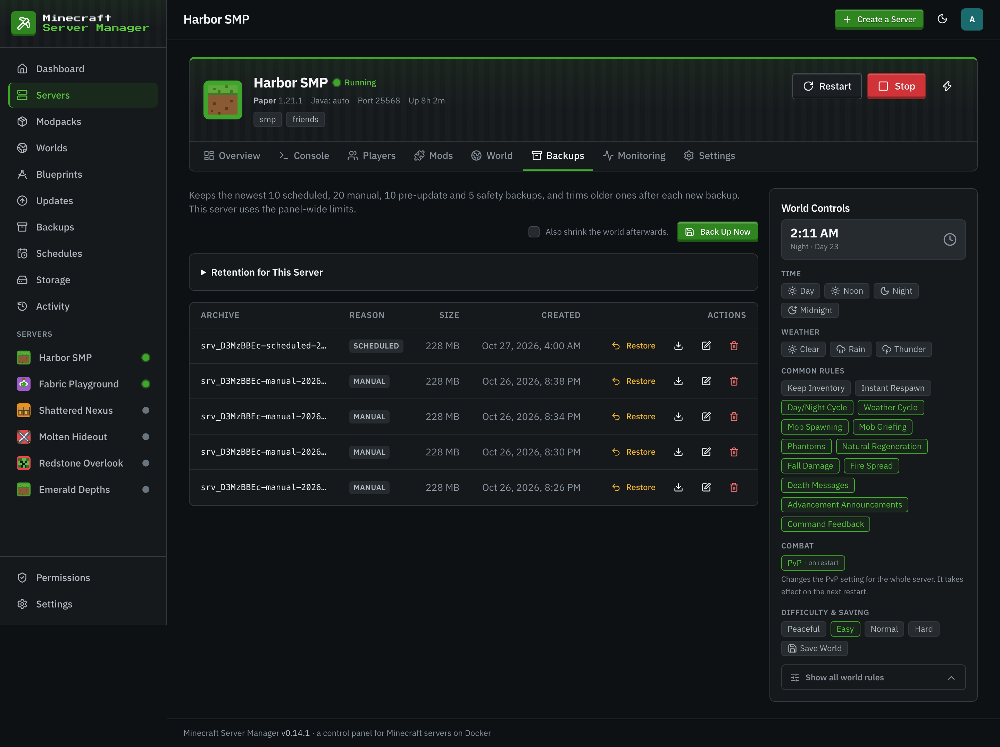

[← Geri belgeler dizinine](/docs/)

**Yedekler** sayfası, boyut, neden ve yaş ile birlikte tüm sunucu filonuzdaki anlık görüntüleri gösterir; sunucuya ve nedene göre filtrelenebilir.

## Yedekleme Oluşturma

Bir sunucunun **Yedekler** sekmesinden (veya bir [zamanlama](/docs/schedules/) aracılığıyla) tek tıklamayla tüm sunucu dizinini anlık olarak kaydedebilirsiniz. Panel, dünyayı önce sakinleştirir (`save-off` → `save-all`), verileri zip'ler, ardından kaydı yeniden etkinleştirir (`save-on`), böylece yedekler çalışan bir sunucuda bile tutarlı olur. Sıkıştırma, paneli durdurmadığı için arka plan bir iş parçacığında çalışır. API aracılığıyla başlatılan bir yedekleme bir not taşıyabilir.

Her arşiv, yazıldığı anda **bütünlük kontrolünden** geçer: panel zip dosyasını yeniden açar ve dizinini okur. Bozuk veya açılamayan bir arşiv silinir ve yedekleme çağrısı, geri yükleme yapmanın veri kaybı ile aranızdaki tek şey olduğu aylarca sonra sorun ortaya çıkmak yerine o anda başarısız olur. Sıfır girişli bir arşiv (hiç başlamamış bir sunucu) izin verilir ancak olayda işaretlenir.

Arşiv güvenli bir şekilde yazıldıktan sonra nadiren ziyaret edilen parçaları kaldırmak için **"Ayrıca dünyayı küçült"** seçeneğini işaretleyin (Yedekler sekmesinde veya bir yedekleme zamanlamasında) (**[Dünyayı Küçültme](/docs/world-shrink/)** bölümüne bakın). Küçültme yalnızca sunucu durdurulduğunda çalışır; çalışan bir sunucuda yedekleme yine de gerçekleşir ve küçültme atlanır.

## Yedekleme Nedenleri

Yedekler, neden alındıklarına göre etiketlenir:

- **manuel**: **Şimdi Yedekle** düğmesine tıkladınız. Bir sunucunun aktif dünyasını kütüphaneden bir tanesiyle değiştirmek de önce bir `manuel` yedek alır.
- **zamanlanmış**: bir [zamanlama](/docs/schedules/) tarafından oluşturulmuştur. Her yeni sunucuya otomatik olarak günlük zamanlanmış bir yedek de eklenir (02:00 ile 05:59 arasında değişen zamanlarda), böylece bir sunucu güncellemelerden önce değil, ilk günden itibaren otomatik kapsama alanına sahip olur.
- **güncelleme-öncesi**: bir paket yükseltmesi veya Minecraft sürümü değişikliğinden önce otomatik olarak alınır, böylece bir yükseltme her zaman geri alınabilir.
- **geri-yükleme-öncesi**: geri yükleme veya dünya sıfırlamasından hemen önce otomatik olarak alınır, geri yüklemenin istediğiniz şey olmadığı durumda bir güvenlik ağı olarak.

## Saklama

Saklama, **sunucu başına, nedene göre** sınırlandırılmıştır: her gruptaki en yeniler tutulur, eskiler her başarılı yedekten sonra otomatik olarak temizlenir:

| Neden               | Varsayılan Olarak Tutulan |
| ------------------- | ------------------------- |
| zamanlanmış         | 10                        |
| güncelleme-öncesi   | 10                        |
| manuel              | 20                        |
| geri-yükleme-öncesi | 5                         |

`geri-yükleme-öncesi` (panelde güvenlik yedekleri olarak adlandırılır) kendi küçük kovasına sahiptir, böylece otomatik bir güvenlik yedeği sizin bilinçli olarak tuttuğunuz bir `manuel` yedekyi asla silemez.

Nedene göre sayımların üzerine ek olarak iki isteğe bağlı tavan uygulanır, her ikisi de varsayılan olarak kapalıdır: **maksimum yaş** (N günden eski yedekler, nedeni ne olursa olsun temizlenir) ve sunucu başına **maksimum toplam boyut** (toplam sığana kadar eskiler temizlenir: önce güvenlik yedekleri, sonra zamanlanmış olanlar, sonra geri kalanlar). Bir sunucunun en yeni yedeği bu tavanlardan hiçbiri tarafından temizlenmez.

### Değiştirme

Yöneticiler, **Ayarlar** sayfasındaki **Yedek Saklama** kartında panel genelindeki politikayı belirler (**Yerleşik Değerleri Doldur** varsayılanları yukarıda formda kaydedilmeye hazır olarak geri yükler). Bir sunucu altı değerin herhangi birinde farklılık gösterebilir: **Yedekler** sekmesini açın ve **Bu Sunucu İçin Saklama**'yı genişletin. Oradaki her alan, o sunucu onu ayarlamadıkça boştur ve boş alan panel genelindeki değeri izler (içinde gösterilir). Böylece bir sunucu, örneğin, 3 zamanlanmış yedek tutabilir ve diğer her şey için panel genelindeki değerleri kullanabilir; bir alanı temizlemek onu panel genelindeki değere geri döndürür.

Kaydetme asla tek başına bir şey silmez. Yeni sınırlar mevcut yedekleri limitin üzerine çıkarırsa, panel sunucu başına kaç adet yedek türünün gideceğini, bunun ne kadar alan boşalttığını ve en eskilerinin kaç yaşında olduğunu listeler. Ayrıca, bir sunucunun daha önceki bir **Bir Sonraki Yedekten İtibaren** uygulamasından sonra olduğu gibi, bu değişiklikten önce zaten limitlerinin üzerinde olup olmadığını da söyler, çünkü şimdi uygulamak limitin üzerindeki her şeyi kırpar, yalnızca bu düzenlemenin eklediği değil. Ardından bunları nasıl uygulayacağınızı sorar:

- **Şimdi Kaldır** tam olarak listelediği yedekleri siler, fazlası değil: bu arada yapılan bir yedek bir sonraki kırpmayı bekler. Ayarlar sayfasından, geri yükleme, yedekleme veya benzeri bir işlem ortasındaki bir sunucu atlanır ve bir sonraki yedeğinden sonra kırpılır; sunucunun kendi Yedekler sekmesinde, o işlem bitene kadar tekrar denemeniz istenir. Bir sunucunun eski yedekleri silinirken (genellikle saniyeler), o sunucudaki diğer işlemler beklemek zorundadır: o sırada gerçekleşen zamanlanmış bir yedek veya başlatma, bir dakika boyunca her dakika tekrar dener (30 dakikaya kadar), çökmüş bir sunucu bitiminden yaklaşık 20 saniye sonra yeniden başlatılır (30 dakikaya kadar) ve bununla çakışan zamanlanmış bir yeniden başlatma veya durdurma bir sonraki zamanına kadar atlanır.
- **Bir Sonraki Yedekten İtibaren** şimdilik tutar; her sunucu, her zaman yaptığı gibi, bir sonraki yedeklemesini yaptığında yedeklerini kırpar.

Geri yüklenmekte olan bir yedek, geri yükleme çalışırken asla kaldırılmaz: saklama onu yalnız bırakır (ve onun için yer açmak üzere diğer yedekleri silmez) ve geri yükleme bitene kadar elle silinmesi reddedilir.

Aynı ayarlar, yönetici API uç noktaları olarak betiklere de sunulur: `GET`/`POST /api/backups/retention` ve `/api/servers/:id/backups/retention`. Panel genelindeki değerler `null` olamaz. Bir sunucu için, `null` (veya `""`) değeri o anahtarı kaldırır, böylece tekrar panel genelindeki değeri izler ve `{ "reset": true }` hepsini kaldırır. Bu iki yolun her birinin altında, `POST …/preview` bir değişikliğin neyi kaldıracağını kaldırmadan bildirir (`backups`, `bytes`, `servers`, `ids` ve sunucu başına `byServer` dökümü) ve `POST …/apply` kaydedilen politikayı şimdi uygular ve panel genelinde `{ deleted, skipped }` ( `skipped` meşgul sunucuları sayar) veya tek bir sunucu için `{ deleted }` yanıtını verir. Önizlemenin `{ "token": "..." }` (10 dakika saklanır) veya `{ "ids": [...] }`'sini yalnızca bunları silmek için gönderin; hiçbiri olmadan, limitin üzerindeki her şey gider. Meşgul bir sunucudaki sunucu başına uygulama 409 yanıtını verir.

Yedekler, yedek listesinden **yeniden adlandırılabilir** (her satırdaki yeniden adlandırma düğmesi). Disk üzerindeki arşiv ve panelin kaydı birlikte hareket eder, böylece indirme, geri yükleme ve saklama yeni adla çalışmaya devam eder.

> Saklama otomatik olarak sınırlanır, ancak büyük modlu arşivler yine de bir sunucunun [disk kotasına](/docs/storage/) dahil edilir, bu nedenle büyük paketler için toplamı göz önünde bulundurun.

## Geri Yükleme

Bir yedeği geri yüklemek sunucuyu durdurur (dosyalara dokunmadan önce kapsayıcının gerçekten durduğunu doğrular), bir `geri-yükleme-öncesi` güvenlik yedeği alır, **tüm sunucu dizinini** anlık görüntüyle değiştirir ve yeniden başlatmanız için durdurulmuş olarak bırakır. Arşiv önce yan tarafa açılır ve yalnızca tamamen çıkarıldıktan sonra değiştirilir, böylece geri yükleme yarıda kesilirse mevcut dosyalar dokunulmadan kalır. Paket yükseltmeleri her zaman önce bir `güncelleme-öncesi` yedek aldığı için, kötü bir yükseltmeyi her zaman geri alabilirsiniz.

## Panelin Kendi Veritabanı

Sunucu yedekleri yalnızca her sunucunun kendi klasörünü kapsar. Panelin kendi veritabanı (`panel.db`, kullanıcıları, rolleri, 2FA sırlarını, zamanlamaları, paket sabitlemelerini ve geçmişi tutar) günlük bakım zamanlayıcısında ayrı olarak anlık görüntülenir:

- `VACUUM INTO`, veri klasöründeki `backups/_panel/` içine tutarlı, parçalanmamış bir kopya yazar; en yenisi **14** tutulur.
- Başlatıldığında panel `PRAGMA integrity_check` çalıştırır ve başarısız olursa yüksek sesle günlüğe kaydeder, sizi en yeni iyi kopya için `backups/_panel`'e yönlendirir.

Tüm veri klasörünü yedeklerseniz (aynı zamanda beklemedeki şifreleme anahtarı olan `.secret-key`'i de içerir) her şeyi yedeklemiş olursunuz.
