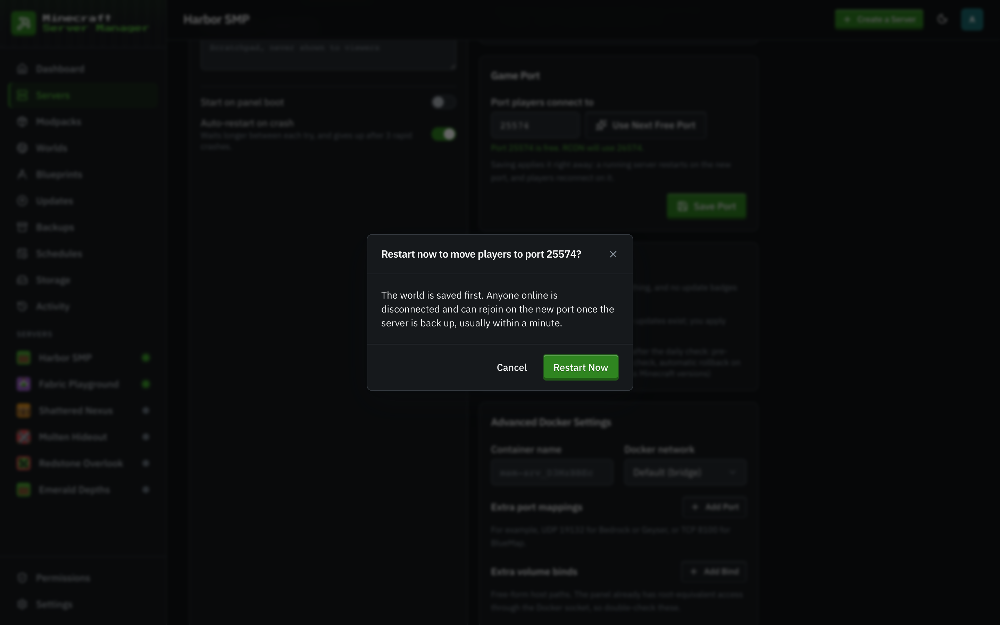

[← Назад до індексу документації](/docs/)

## Створення сервера

Натисніть **Create a Server** (у верхній панелі) або картку **Create a Server**, щоб відкрити майстер.

Майстер попередньо заповнює розмір купи Java та квоту диска з розділу **Defaults for new servers** на сторінці Налаштування, які адміністратор може змінити будь-коли. Новий сервер також отримує обмеження ЦП звідти.

Ви обираєте:

- **Ім'я** (та необов'язковий опис, значок та акцентний колір). Теги для організації вашого парку додаються пізніше, у налаштуваннях сервера.
- **Тип сервера**: Vanilla, Paper або Purpur на вкладці **Vanilla**. Для модифікованого сервера вкладка **From Mods** обирає завантажувач (Fabric, Forge, NeoForge або Quilt), версію Minecraft та збірку завантажувача (останню або конкретну), а потім дозволяє шукати моди.
- **Версію Minecraft**: `LATEST`, знімок або конкретну версію (включаючи бета- та альфа-версії).
- **Ігровий порт**: пропонується вільний. Віддалена консоль (RCON) використовує порт на 1000 вище (за замовчуванням). Ви можете змінити його пізніше (див. [Зміна ігрового порту](#changing-the-game-port)).
- **Ресурси**: купа Java (обмеження пам'яті контейнера встановлюється на 50% вище) та квота диска.

**Advanced Options** відкриває всі інші налаштування, які підтримує образ сервера, плюс додаткові змінні середовища та (для адміністраторів) розширені налаштування Docker.

Віддаєте перевагу модпаку? Вкладка **From Modpack** встановлює пакет CurseForge, Modrinth або GT New Horizons натомість (див. [Modpacks](/docs/modpacks/)), або приймає **custom zip, який ви завантажуєте**: Modrinth `.mrpack`, експорт модпаку CurseForge (`manifest.json`), або будь-який zip з файлами модів. Маніфест (або більшість голосів серед ідентифікованих файлів) заповнює завантажувач та версію Minecraft, і кожен мод встановлюється одним завданням. Ви також можете почати з збереженого [Blueprint](/docs/blueprints/) на вкладці **From Blueprint**.

Панель автоматично обирає відповідне середовище виконання Java для вашої версії, завантажує образ, створює контейнер і запускає його, все з однієї форми.

## Список серверів

Сторінка **Servers** перелічує весь ваш парк із статусом та швидкою статистикою.

## Окремий сервер

Відкриття сервера надає вам робоче середовище з вкладками:

- **Overview**: адреса для спільного використання з гравцями, опис, поточне використання та хто онлайн.
- **Console**: потік логів у реальному часі та введення команд, внутриігровий чат та [команди чату](/docs/console-and-chat/).
- **Players**: список гравців, а також інвентар та статистика.
- **Mods**: список встановлених модів, [браузер модів](/docs/modpacks/) та оновлення контенту. На модифікованому сервері його підвкладка **Versions** перевіряє, для яких майбутніх версій Minecraft існують збірки ваших модів ([оновлення](/docs/updates/#minecraft-version-compatibility)).
- **World**: [світи, карта в реальному часі та файловий менеджер](/docs/worlds-and-files/).
- **Backups**: [знімки та відновлення](/docs/backups/) для цього сервера.
- **Monitoring**: історія та метрики в реальному часі для кожного сервера, включаючи звіти про збої (див. нижче).
- **Settings**: **Configuration** (все про те, як працює сервер), плюс [інтеграції](/docs/integrations/) (Discord, Status Page, Invites та, для адміністраторів, Chatbot).

Елементи керування запуском, зупинкою та перезапуском розташовані у заголовку над кожною вкладкою. Те, що ви можете робити на кожній вкладці, залежить від ваших [дозволів на цьому сервері](/docs/users-and-roles/#per-server-permissions): наприклад, підвкладка **Files** потребує дозволу Files, а надсилання команд консолі — дозволу Console.

Панель **World Controls** завжди присутня на кожній вкладці: внутрішньоігровий годинник, погода, поширені правила гри як перемикачі, та "Show all world rules" для решти.

**Monitoring → Live** показує TPS та мілісекунди на тік, картку стану та стабільності зі збоями (за останні 24 години та 7 днів), вимкненнями через брак пам'яті та автоматичними перезапусками, а також розміри для кожного світу.

## Налаштування сервера

**Settings → Configuration** — це повна поверхня конфігурації: ім'я, опис, MOTD, значок, колір та теги, ресурси, ігровий порт, політика оновлення, запуск під час завантаження панелі та автоматичний перезапуск після збою, кожна змінна середовища, яку підтримує образ сервера, розширені налаштування Docker, а також експорт, клонування, перебудова та видалення шаблонів. Зміни, які набувають чинності лише після перебудови сервера, зберігаються негайно і чекають: кнопка **Apply Changes** з'являється у заголовку сервера, і вони також застосовуються під час наступного запуску сервера.

**Auto-restart on crash** знову запускає збійний сервер, збільшуючи інтервал між спробами (5, 10, потім 20 секунд) і зупиняючись після 3 спроб протягом 10 хвилин. Він пропускає збої, які панель розпізнає як проблему налаштування (EULA, неправильна версія Java, світ з новішої версії, зайнятий порт, брак пам'яті, відсутній ключ CurseForge), оскільки вони потребують виправлення спочатку. Якщо інша дія зайнята сервером (резервне копіювання, відновлення, зміна порту), вона чекає до 30 хвилин і здається, як тільки хтось зупиняє або запускає сервер самостійно.

Прямі зміни налаштувань завжди зберігаються між перезапусками. Зміна PvP або складності, зроблена за допомогою панелі **World Controls**, перемикач білого списку на вкладці **Players** або редагування `server.properties` в редакторі **Files** видаляє відповідну змінну середовища (якщо вона була встановлена) і позначає сервер для перебудови, тому значення на диску переважає, а не повторно застосовується образом контейнера під час наступного запуску.

**Про лічильник пам'яті.** "RAM (Java heap)" передається Java як початковий, так і максимальний розмір купи, і Java заповнює виділену купу протягом першої хвилини, з прапорами Aikar / MeowIce або без них. Тому лічильник пам'яті осідає приблизно на розмірі купи і залишається там, навіть коли ніхто не грає; позначка на лічильнику вказує, де купа знаходиться під обмеженням контейнера, і примітка під ним це пояснює. Якщо ви віддаєте перевагу, щоб пам'ять відповідала реальному використанню, встановіть для сервера менший початковий розмір купи за допомогою **Initial heap** у картці Resources на **Settings → Configuration** (або в розділі **Advanced Options** у майстрі), наприклад, 512 МБ: на купі 2 ГБ це зменшило використання в режимі простою з 2,6 ГБ до приблизно 1,3 ГБ за нашими вимірюваннями. Java також потребує пам'яті поза купою (приблизно 0,5 ГБ для Vanilla, 1,5-2 ГБ для великого модпаку), для чого призначений запас обмеження контейнера. Дивіться README "Two memory limits" для точних цифр.

> **Advanced Docker Settings** (ім'я контейнера, мережа Docker, додаткові відображення портів та додаткові прив'язки томів) доступні **тільки адміністраторам**, оскільки прив'язка тому разом із доступом панелі до Docker фактично надає root-права на хості. Див. [Users & roles](/docs/users-and-roles/).

### Зміна ігрового порту

Картка **Game Port** на **Settings → Configuration** дозволяє перемістити сервер на інший порт будь-коли, за допомогою власної кнопки **Save Port**. **Use Next Free Port** обирає найнижчий вільний порт, а картка перевіряє будь-який введений вами порт перед збереженням. RCON завжди йде на 1000 вище ігрового порту (зміщення за замовчуванням). Адміністратори можуть обирати будь-який порт від 1024 і вище; всі інші обирають від першого ігрового порту (25565 за замовчуванням) і вище. Збереження застосовує зміни негайно: зупинений сервер просто переміщується, а запущений спочатку запитує дозвіл, а потім перезапускається на новому порту (світ спочатку зберігається, а гравці перепідключаються на новому порту). Якщо сервер не може запуститися на новому порту, він повертається до старого. Зміна відмовляється, поки інші зміни чекають на **Apply Changes**, тому спочатку застосуйте їх. Зміна порту потребує дозволу Settings на цьому сервері.

## Звіти про збої та аналіз mclo.gs

Звіти про збої (`crash-reports/*.txt` та файли JVM `hs_err_pid*.log`) автоматично збираються, парсяться до однорядкового резюме з винятком та підозрюваними модами, і перелічуються в розділі **Monitoring → History**:

Кожна картка звіту пропонує вбудований переглядач (зі згортаними секціями та виділеними винятками), копіювання стека викликів та завантаження, а також дві дії [mclo.gs](https://mclo.gs):

- **Share to mclo.gs** публікує звіт як загальнодоступну вставку та копіює посилання: саме те, що просять автори модів та служби підтримки Discord. Посилання запам'ятовується для звіту, тому нічого не завантажується двічі.
- **Analyze** запускає автоматизовані інсайти mclo.gs над вставкою: відомі проблеми з запропонованими виправленнями (відсутні залежності, невідповідність версій, поширені конфлікти модів), відображені безпосередньо в панелі.

Обидві дії вимагають явного підтвердження, оскільки вставка є публічною: звіти про збої можуть містити імена гравців та повний список ваших модів. Панель ніколи нічого не завантажує самостійно.
