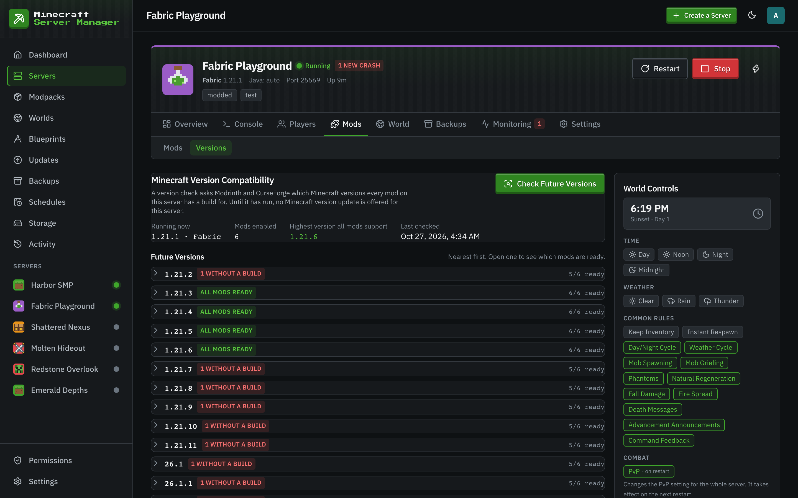

Ukrainian (uk):

[← Назад до індексу документації](/docs/)

Сторінка **Оновлення** відстежує застаріле програмне забезпечення на всіх ваших серверах в одному місці:

- Версії **модпаків** ([модпаки](/docs/modpacks/)) порівняно з Modrinth / CurseForge / індексом випусків GTNH.
- **Власний контент**, який ви додали самостійно (моди, датапаки, ресурсні паки, плагіни), кожен порівняно з його джерелом: Modrinth, CurseForge, Hangar, SpigotMC (Spiget) або GitHub Releases. Пошук на GitHub використовує повторну перевірку ETag, тому щоденні перевірки майже не впливають на ліміт запитів.
- Застарілість **Docker-образу**: ідентифікатор образу кожного контейнера сервера порівняно зі свіжозавантаженим тегом (дублікати видаляються для серверів з однаковим тегом), пропонується як оновлення лише для перезбірки.
- **Фіксовані версії**: для сервера без керованого пакету, явне закріплення `mc_version` порівняно з маніфестом Mojang та явна змінна середовища завантажувача (`PAPER_BUILD`, `FORGE_VERSION` тощо) порівняно з реєстром завантажувача. Збірки Paper надходять з поточного **Fill v3 API** PaperMC (застарілий кінцевий пункт v2 припинив отримувати нові версії Minecraft). На сервері з модами нова версія Minecraft пропонується лише після того, як [перевірка версій](#minecraft-version-compatibility) покаже, що кожен встановлений мод має для неї збірку. Закріплений сервер Forge отримує рекомендовану збірку Forge, ніколи не збірку, старішу за ту, до якої він закріплений, а сервер, закріплений за релізом, ніколи не отримує пре-реліз (той, що вже на бета-версії, може отримати новішу бета-версію або реліз). Застосування збірки завантажувача спочатку створює резервну копію перед оновленням. Переміщення сервера Forge або NeoForge на нову версію Minecraft очищає його закріплений номер збірки завантажувача, оскільки збірка створюється для однієї версії Minecraft; ключове слово, таке як `latest`, зберігається, оскільки воно самостійно слідує за версією. Щоб вибрати певну збірку самостійно, див. [зміна версії завантажувача модів](#changing-the-mod-loader-version).

## Як це працює

Панель перевіряє закріплені версії кожного сервера порівняно з вихідним джерелом і перелічує все, що має новий випуск. Відповідна кількість також з'являється на плитці "Доступні оновлення" на [панелі керування](/docs/dashboard/).

Перевірки виконуються щодня за замовчуванням [розкладом](/docs/schedules/) та за запитом за допомогою **Перевірити все зараз**. **Ігнорувати** в рядку зупиняє пропозицію цієї конкретної версії; нова версія буде запропонована знову. **Політика** оновлення є індивідуальною для кожного сервера: панель залишає все вручну (за замовчуванням, що також тримає сервер поза цією сторінкою), просто повідомляє вас, або самостійно застосовує оновлення пакету ([політика оновлення](/docs/modpacks/#update-policy)).

## Сумісність версій Minecraft

Новіша версія Minecraft не є оновленням, якщо ваші моди не можуть перейти з нею. Кожен сервер має свою власну вкладку **Версії** (у розділі Моди), яка відповідає на це питання:

- Версія, яку сервер запускає зараз, і **найвища версія, для якої кожен встановлений мод має збірку**.
- Один згорнутий рядок для кожної майбутньої версії Minecraft, із зазначенням кількості готових модів та кількості модів, для яких ще нічого не опубліковано. Відкрийте рядок, щоб побачити, які моди залишаться позаду, а які в порядку.

Натисніть **Перевірити майбутні версії**, щоб запустити її. Нічого не сканується самостійно: перевірка читає кожен jar у папці модів сервера та запитує Modrinth і CurseForge про кожен з них, тому це відбувається лише тоді, коли ви просите. Прогрес і часткові результати записуються під час роботи, тому закриття сторінки або оновлення нічого не втрачає, а перевірка, перервана перезапуском панелі, повідомляє про це та пропонує запустити знову. Все, що перервана перевірка вже опрацювала, зберігається, тому повторний запуск не повторює цю роботу.

Звіт описує лише сервер, для якого він був створений. Змініть версію Minecraft, завантажувач або самі моди (додайте один, видаліть один, оновіть один), і звіт буде позначено як застарілий і перестане використовуватися, доки ви знову не запустите перевірку.

Моди ідентифікуються зі списку файлів самого модпаку, якщо він є, а в іншому випадку за вмістом файлу, так само, як запускач розпізнає jar. Два типи модів не можуть бути перевірені, і жоден з них не вгадується:

- **Не вдалося ідентифікувати**: створений вручну jar або приватна збірка, яку не розпізнає жоден реєстр.
- **Не вдалося перевірити**: мод з GitHub Releases, Hangar або SpigotMC, або той, чий проект було видалено. Вони не публікують список версій Minecraft, для яких призначена кожна збірка.

Поки встановлено будь-який з них, панель взагалі не запропонує оновлення версії Minecraft в один клік, оскільки вона не може чесно сказати, що зламається. Застосування версії вище за ту, яку підтримують моди, відхиляється, і називає моди, які її блокують.

Моди, які ви **вимкнули**, не беруть участі: сервер їх не завантажує, тому вимкнення моду є реальним способом подолати блокувальник. Увімкнення або вимкнення моду позначає звіт для повторної перевірки.

Це стосується серверів, які запускають моди: Fabric, Forge, NeoForge та Quilt. Сервери плагінів у стилі Paper зберігають звичайну поведінку найновішого випуску та не мають вкладки "Версії", оскільки два реєстри, з яких надходять плагіни, не публікують нічого, що перевірка могла б прочитати.

Відкриття версії спочатку перелічує моди без збірки для неї (ті, що визначають відповідь), а готові тримає за кліком. Великі пакети завантажують сторінку модів за раз, так що сервер з 300 модами відкривається так само швидко, як і з п'ятьма модами.

## Зміна версії завантажувача модів

Вкладка **Версії** також має картку **Версія завантажувача**. Вона показує, яка збірка Forge, NeoForge, Fabric або Quilt встановлена на сервері, і, де її можна змінити, вибір для переходу на іншу.

- **Сервер Forge, NeoForge, Fabric або Quilt** може запускати будь-яку опубліковану збірку. Вибір перелічує останні збірки для версії Minecraft сервера, з позначками рекомендованої та останньої збірок Forge. **Інша збірка…** приймає будь-яку старішу за її номером, а **За замовчуванням** повертає керування серверу.
- **Модпак Forge або Fabric CurseForge** встановлює версію завантажувача, яку декларує його власний маніфест, тому звичайний спосіб її зміни — оновити пакет. Коли сам пакет вказує неправильну версію (мод у ньому запитує новіший Forge, ніж встановлює пакет), картка може перевизначити її, а **Версія модпаку** знову видаляє перевизначення. Оновлення пакету також видаляє його, оскільки нова версія декларує власний завантажувач. Якщо нова версія все ще вказує неправильну, встановіть перевизначення знову.
- **Модпак NeoForge CurseForge або модпак Modrinth** показує свій завантажувач, але його не можна перевизначити: образ сервера застосовує перевизначення лише до пакетів Forge та Fabric. Його завантажувач слідує за версією пакета, тому оновіть пакет замість цього. Завантажувач пакету FTB також не можна змінити тут. Його картка зазвичай не з'являється, оскільки власний інсталятор FTB зберігає записи, які панель не читає.

Панель перевіряє, чи існує збірка, перш ніж запитувати вас про щось. Збірка Forge або NeoForge створюється для однієї версії Minecraft, тому на сервері, який слідує за найновішим випуском, закріплення однієї також утримує сервер на версії Minecraft, яку він зараз запускає (підтвердження це говорить). Вибір **За замовчуванням** після цього видаляє закріплення, але зберігає цю версію Minecraft. Сервер, який слідував за найновішим випуском, також може перейти на інший образ Java під час перезбірки, той, який потрібен цій версії. Такому серверу, який ніколи не запускався, пропонується запуститися один раз, щоб панель знала цю версію. Forge пропускає номери збірок (немає 47.4.14 між 47.4.13 і 47.4.15), тому мод, який "вимагає 47.4.14 або вище", задовольняється наступною збіркою вгору, і відмова називає його. Зміна створює резервну копію перед оновленням, а потім перезбирає сервер. Нова збірка встановлюється наступного разу, коли сервер запускається, і картка повідомляє про це до тих пір.

## Скасування оновлення моду

Кожна збірка, з якої оновлюється мод, залишається у спільній бібліотеці, тому оновлення, яке щось зламало, можна скасувати. Рядок моду на вкладці **Моди** отримує кнопку **Відновити**, яка повертає попередню збірку. Завантаження немає, тому це працює, навіть якщо проект з тих пір було видалено з реєстру. Збірка, від якої ви відмовилися, більше не пропонується, доки не з'явиться новіша.

## Застосування оновлення

Оновлення ніколи не бувають безшумними. Коли ви обираєте оновити пакет (або [переключити його на іншу версію](/docs/modpacks/#changing-the-pack-version), включаючи старіші), панель:

1. Створює **резервну копію перед оновленням** (щоб її можна було скасувати; за замовчуванням зберігається останні 10 резервних копій перед оновленням на сервер, див. [збереження](/docs/backups/#retention)).
2. Перезакріплює точну нову версію.
3. Перезбирає сервер, повторно визначаючи середовище виконання Java за потреби.
4. Відстежує перший запуск з часовим бюджетом на платформу.

Якщо він не запускається належним чином, ви відкочуєтеся до резервної копії перед оновленням. Сервер, який відстежує стабільні версії, ніколи не отримує бета-версію, а посилання на журнал змін вказує на реальний диференціал для кожної версії, де джерело надає його. Невдале оновлення також надсилає сповіщення Discord [сповіщення](/docs/integrations/), якщо інтеграція налаштована.
