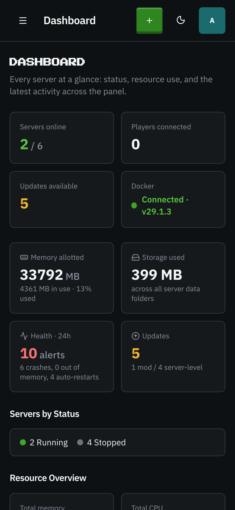

[← Quay lại mục lục tài liệu](/docs/)

## Thiết lập lần đầu

Lần đầu tiên bạn mở bảng điều khiển, nó sẽ yêu cầu bạn tạo một tài khoản quản trị viên. Đây là tài khoản duy nhất tồn tại cho đến khi bạn thêm tài khoản khác và nó có toàn quyền kiểm soát.

Chọn một tên người dùng và mật khẩu có ít nhất 8 ký tự. Vậy là xong: bạn đã đăng nhập và được đưa thẳng đến bảng điều khiển.

> **Các cài đặt được hiển thị ra ngoài được bảo vệ bằng PIN.** Nếu bạn khởi động bảng điều khiển được liên kết với một địa chỉ không phải loopback (`PANEL_HOST` khác với `127.0.0.1`), trang thiết lập cũng sẽ yêu cầu một **mã PIN gồm 6 chữ số**. Bảng điều khiển sẽ in mã này ra bảng điều khiển của nó khi khởi động. Nhập mã này cùng với tên người dùng và mật khẩu của bạn. Điều này ngăn chặn kẻ lạ mặt truy cập cổng trước tiên chiếm đoạt tài khoản quản trị viên. Mã PIN sẽ biến mất sau khi tài khoản quản trị viên tồn tại.

## Đăng nhập

Sau khi thiết lập, bảng điều khiển sẽ được bảo vệ bằng màn hình đăng nhập. Nhập tên người dùng và mật khẩu của bạn để tiếp tục.

Nếu [xác thực hai yếu tố](/docs/two-factor-authentication/) được bật cho tài khoản của bạn, bạn sẽ được yêu cầu nhập mã gồm 6 chữ số từ ứng dụng xác thực của bạn ngay sau mật khẩu.

## Tìm hiểu cách sử dụng

Mọi thứ đều nằm ở thanh bên trái:

- **Bảng điều khiển** - xem nhanh tất cả các máy chủ ([chi tiết](/docs/dashboard/)).
- **Máy chủ**, **Modpacks**, **Thế giới**, **Bản thiết kế** - tạo và quản lý máy chủ và nội dung của chúng.
- **Cập nhật**, **Sao lưu**, **Lịch trình**, **Lưu trữ**, **Hoạt động** - khía cạnh vận hành: những gì đã lỗi thời, các bản chụp nhanh của bạn, tự động hóa, việc sử dụng đĩa và nhật ký kiểm toán.
- **Cài đặt** (dưới cùng): người dùng, khóa API và cấu hình bảng điều khiển.

Thanh trên cùng có nút **Tạo máy chủ**, **công tắc chủ đề** (tối/sáng) và **menu tài khoản** của bạn, nơi bạn có thể quản lý [xác thực hai yếu tố](/docs/two-factor-authentication/) hoặc đăng xuất.

## Trên điện thoại hoặc máy tính bảng

Mọi trang đều được bố trí trước tiên cho màn hình hẹp và sau đó mở rộng ra: thanh bên được ẩn sau nút menu, bảng dữ liệu được xếp chồng thành các thẻ, thanh công cụ được gói lại và thanh điều khiển thế giới thu gọn thành một thẻ mà bạn mở khi cần. Các nút và chip có kích thước vùng chạm thực tế. Không có gì chỉ dành cho máy tính để bàn.

  
  
  
  
  

## Những gì bạn cần

Bảng điều khiển giao tiếp với Docker để chạy máy chủ, vì vậy nó cần quyền truy cập vào một daemon Docker (Docker Desktop hoặc Docker Engine socket). Khi Docker có thể truy cập được, ô Docker trên bảng điều khiển sẽ hiển thị **Đã kết nối** và phiên bản của nó. Nếu không, bảng điều khiển vẫn chạy. Bạn chỉ không thể khởi động máy chủ cho đến khi daemon hoạt động.

## Các bước tiếp theo

- [Tạo máy chủ đầu tiên của bạn →](/docs/servers/)
- [Bảo mật tài khoản của bạn bằng 2FA →](/docs/two-factor-authentication/)
