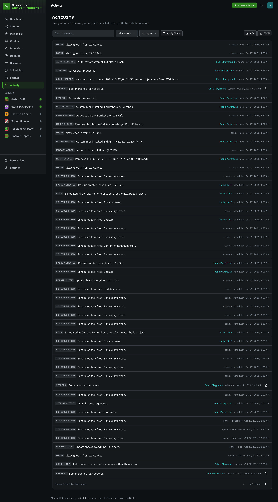

[← 返回文件索引](/docs/)

**活動記錄**頁面是完整的稽核紀錄：一個可搜尋、依時間順序排列的紀錄，包含面板中發生的所有事件。

## 記錄的內容

- **驗證** - 登入（包括是否使用雙重驗證或備份碼），以及啟用、停用或重設雙重驗證。
- **伺服器生命週期** - 建立、啟動、停止、重新啟動、當機和記憶體不足的事件。
- **警報** - 啟動停滯、停止失敗、排程失敗、配額停止、容器異常、重新啟動後離線。
- **資料** - 建立和還原備份、匯出藍圖、安裝和升級套件。
- **設定** - 聊天指令變更、角色變更和設定編輯。

每筆記錄都會記錄是誰執行的（使用者名稱，或面板/排程器用於自動化動作）、與哪個伺服器相關，以及發生的時間。 [儀表板](/docs/dashboard/) 顯示最新的幾筆記錄；此頁面是完整的歷史紀錄。生命週期和警報事件也可以轉發到 Discord（請參閱 [整合](/docs/integrations/)）。

由於它會記錄安全相關事件（登入、雙重驗證變更、角色變更），如果帳戶出現異常，活動記錄也是您首先要檢查的地方。
