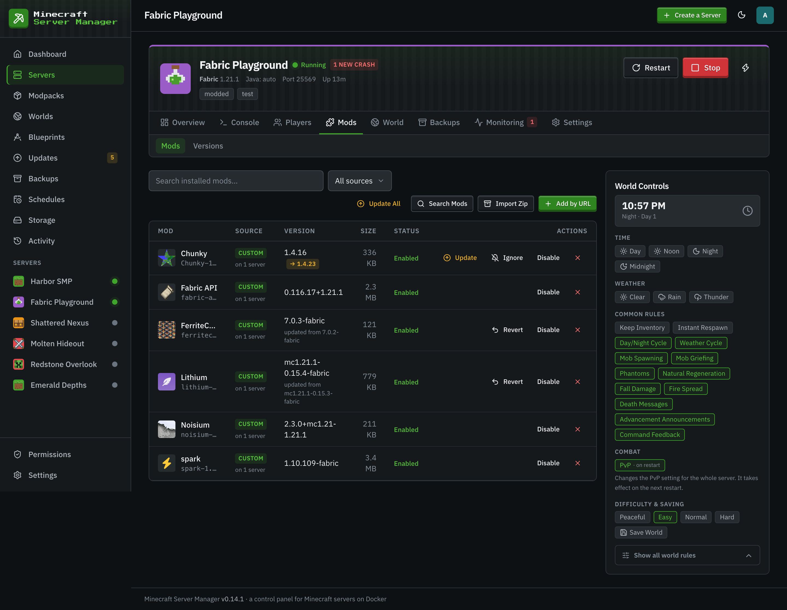

[← 返回文件索引](/docs/)

**更新**頁面可集中追蹤您所有伺服器中的過時項目：

- **模組包**版本（[模組包](/docs/modpacks/)）與 Modrinth / CurseForge / GTNH 發佈索引進行比較。
- 您自行添加的**自訂內容**（模組、資料包、資源包、外掛），每個都與其來源進行比較：Modrinth、CurseForge、Hangar、SpigotMC (Spiget) 或 GitHub Releases。GitHub 查詢使用 ETag 再驗證，因此每日檢查幾乎不會觸碰到其速率限制。
- **Docker 映像檔**過時：每個伺服器容器的映像檔 ID 與剛拉取的標籤進行比較（同一標籤的伺服器會去重），提供僅限重建的升級。
- **獨立版本釘選**：對於沒有受管理套件的伺服器，將明確的 `mc_version`釘選與 Mojang 的資訊清單進行比較，並將明確的載入器建置環境變數（`PAPER_BUILD`、`FORGE_VERSION` 等）與載入器的登錄進行比較。Paper 建置來自 PaperMC 的目前 **Fill v3 API**（舊版 v2 端點已停止接收新的 Minecraft 版本）。在帶有模組的伺服器上，僅當 [版本檢查](#minecraft-version-compatibility) 顯示所有已安裝的模組都有對應的建置時，才會提供較新的 Minecraft 版本。釘選的 Forge 伺服器會提供 Forge 推薦的建置，絕不會提供比釘選版本舊的建置，釘選到發佈版本的伺服器絕不會提供預發佈版本（已處於測試版上的伺服器可以提供較新的測試版或發佈版）。套用載入器建置會先進行預更新備份。將 Forge 或 NeoForge 伺服器移至新的 Minecraft 版本會清除其釘選的載入器建置編號，因為一個建置是針對一個 Minecraft 版本製作的；像 `latest` 這樣的關鍵字會被保留，因為它會自行跟隨版本。若要自行選擇特定建置，請參閱 [變更模組載入器版本](#changing-the-mod-loader-version)。

## 運作方式

面板會將每個伺服器的釘選版本與上游來源進行比較，並列出任何有新發佈的版本。在 [儀表板](/docs/dashboard/) 的「可用更新」圖塊上也會顯示匹配的計數。

檢查預設會依照 [排程](/docs/schedules/) 每日執行，並可透過「立即全部檢查」手動執行。某行的「忽略」會停止提供該特定版本；較新的版本將再次提供。更新**策略**是每個伺服器獨立設定：面板會將所有內容保留為手動（預設值，這也會讓伺服器不顯示在此頁面上），僅通知您，或自行套用套件更新（[更新策略](/docs/modpacks/#update-policy)）。

## Minecraft 版本相容性

如果您的模組無法跟隨，較新的 Minecraft 版本就不是升級。每個伺服器都有自己的「版本」標籤（在「模組」下方），可以回答這個問題：

- 伺服器目前執行的版本，以及**每個已安裝模組都有建置的最高版本**。
- 未來每個 Minecraft 版本一個可折疊的列，顯示有多少模組已準備好，以及有多少模組尚未發佈。打開一個列，查看哪些模組將被淘汰，哪些模組則沒問題。

按一下「檢查未來版本」來執行。沒有東西會自行掃描：檢查會讀取伺服器模組資料夾中的每個 jar 檔，並詢問 Modrinth 和 CurseForge 關於每個檔案的資訊，因此這只會在您要求時發生。進度和部分結果會一邊進行一邊寫入，因此關閉頁面或重新整理也不會遺失任何東西，而因面板重新啟動而中斷的檢查會說明情況並提供再次執行的選項。中斷的檢查已完成的所有工作都會被保留，因此再次執行不會重複該工作。

報告僅描述其製作的伺服器。變更 Minecraft 版本、載入器或模組本身（新增、移除、更新）都會導致報告標記為過時並停止使用，直到您再次執行檢查為止。

模組是從模組包本身的檔案清單中識別的（如果有的話），否則則根據檔案內容識別，這與啟動器識別 jar 檔的方式相同。有兩種情況的模組無法回答，也不會進行猜測：

- **無法識別**：手動建置的 jar 或任一登錄檔都不識別的私有建置。
- **無法檢查**：來自 GitHub Releases、Hangar 或 SpigotMC 的模組，或其專案已被移除的模組。這些模組不會發佈每個建置適用於哪個 Minecraft 版本的列表。

只要其中任一模組已安裝，面板就不會提供一鍵式 Minecraft 版本更新，因為它無法誠實地說明哪些會中斷。套用高於模組支援版本的版本將被拒絕，並會指明阻止它的模組。

您**停用**的模組不參與其中：伺服器不會載入它們，因此關閉模組是繞過封鎖程式的有效方法。開啟或關閉模組會將報告標記為需要重新檢查。

這涵蓋了執行模組的伺服器：Fabric、Forge、NeoForge 和 Quilt。Paper 風格的外掛伺服器會保留純粹的最新發佈行為，並且沒有「版本」標籤，因為外掛來源中的兩個登錄檔都不會發佈可供檢查的內容。

打開一個版本會先列出沒有對應建置的模組（決定結果的模組），並將準備好的模組隱藏在點擊後。大型套件一次載入一頁模組，因此 300 個模組的伺服器載入速度與 5 個模組的伺服器一樣快。

## 變更模組載入器版本

「**版本**」標籤還有一個「**載入器版本**」卡片。它顯示伺服器已安裝的 Forge、NeoForge、Fabric 或 Quilt 建置，並在可變更的情況下，提供一個選擇器來切換到另一個。

- **Forge、NeoForge、Fabric 或 Quilt 伺服器**可以執行任何已發佈的建置。選擇器列出了伺服器 Minecraft 版本最近的建置，並標示了 Forge 的推薦和最新建置。「**其他建置…**」可以透過其編號選擇任何較舊的建置，「**預設**」則恢復為讓伺服器自行選擇。
- **Forge 或 Fabric CurseForge 模組包**會安裝其自身資訊清單聲明的載入器版本，因此變更它的常用方法是更新套件。當套件本身列出了錯誤的版本（其中的模組要求比套件安裝的 Forge 更新的版本）時，該卡片可以覆寫它，「**模組包版本**」則會再次移除覆寫。更新套件也會移除它，因為新版本會聲明自己的載入器。如果新版本仍然列出了錯誤的版本，請再次設定覆寫。
- **NeoForge CurseForge 模組包或 Modrinth 模組包**會顯示其載入器但無法覆寫：伺服器映像檔僅對 Forge 和 Fabric 套件套用覆寫。其載入器會跟隨套件版本，因此請更新套件。FTB 套件的載入器也無法在此處變更。其卡片通常不會出現，因為 FTB 自帶的安裝程式會保留面板無法讀取的記錄。

面板會在要求您任何操作之前檢查建置是否存在。Forge 或 NeoForge 建置是針對單一 Minecraft 版本製作的，因此在遵循最新發佈的伺服器上，釘選一個建置也會將伺服器保留在其目前執行的 Minecraft 版本上（確認訊息會說明這一點）。之後選擇「**預設**」會移除釘選但保留該 Minecraft 版本。遵循最新發佈的伺服器在重建時也可能移至不同的 Java 映像檔，即該版本所需的映像檔。從未啟動過的此類伺服器會被要求先啟動一次，以便面板知道該版本。Forge 會跳過建置編號（47.4.13 和 47.4.15 之間沒有 47.4.14），因此「需要 47.4.14 或更高版本」的模組將由下一個較高的建置滿足，並且拒絕會指明該模組。變更會進行預更新備份，然後重建伺服器。新建置將在伺服器下次啟動時安裝，並且卡片會一直顯示直到那時。

## 還原模組更新

模組更新的每個建置都會保留在共用函式庫中，因此會破壞內容的更新是可以復原的。**模組**標籤上的模組列會出現一個「**還原**」按鈕，可將先前的建置還原回去。沒有下載，因此即使專案後來已從其登錄檔中移除，它仍然有效。您還原掉的建置將停止提供，直到出現更新的建置為止。

## 套用更新

更新永遠不會是靜默的。當您選擇升級套件（或[將其切換到另一個版本](/docs/modpacks/#changing-the-pack-version)，包括舊版本）時，面板會：

1. 進行**預更新備份**（因此可復原；預設情況下，每個伺服器保留最後 10 次預更新備份，請參閱[保留期](/docs/backups/#retention)）。
2. 重新釘選確切的新版本。
3. 重建伺服器，並在需要時重新解析 Java 執行環境。
4. 監控首次啟動，並設有每個平台的時限。

如果它未能健康啟動，您將回滾到預更新備份。穩定追蹤的伺服器絕不會提供測試版，變更日誌連結會指向來源提供變更日誌的實際版本差異。失敗的更新也會觸發 Discord [警報](/docs/integrations/)（如果已設定整合）。
